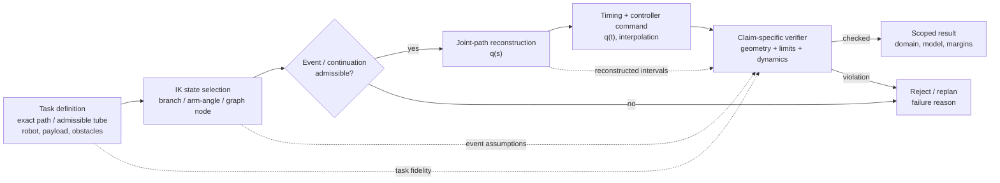

<!-- Gate 7-R7: editorial refinement of R6. Scientific findings F1–F3, historical search/reading states, evidence-depth limits and G0/G1/G2E/G2T task definitions are preserved. -->
# Trajectory-Consistent Inverse Kinematics for Fixed-Base Serial Manipulators: Branch Selection, Singularity Transitions, and Joint/Path Constraints

## Abstract

A sequence of valid inverse-kinematic (IK) solutions need not define a continuous, constraint-compliant joint trajectory for a prescribed Cartesian path. This structured, mechanism-oriented narrative review synthesizes pathwise IK methods along five complementary axes: solution representation, singularity and mode-transition semantics, constraint domain, guarantee object, and validation setting. An applicability-aware T1/T2/T3 comparison examines continuation and events, enforcement of geometric and time-dependent constraints, and verification of the reconstructed motion under compatible robot and task specifications. Evidence from sampled-graph planning, analytical branch transitions, constrained optimization, and integrated planning systems supports three findings. First, path continuation, singularity transitions, and cyclic repeatability describe distinct properties. Second, existing methods combine IK selection and constraints in substantive but architecture- and task-dependent ways. Third, finite-resolution feasibility, trajectory reconstruction, and physical execution provide different forms of evidence that must be aligned with the realized motion. A proposed G0/G1/G2E/G2T common-task benchmark and an evidence-object reporting chain translate these distinctions into explicit comparison and checking obligations. The resulting synthesis offers a task-conditioned framework for evaluating trajectory-consistent IK across heterogeneous studies.

**Keywords:** trajectory-consistent inverse kinematics; branch continuation; singularity events; task-path fidelity; constrained optimization; applicability-aware evidence; verification domain; fixed-base industrial manipulators

## 1. Introduction

For a fixed-base serial manipulator, a sequence of feasible end-effector poses does not uniquely specify how the joints should move between them. A robot may have different IK configurations for each pose, and a locally convenient choice can produce a discontinuity when carried along a process path. Obstacle geometry and actuator limits then impose additional conditions on the selected motion. These issues arise together in toolpath-following tasks, where the trajectory, not merely its endpoint, is part of the specification.

Let \(f:\mathcal Q\to\mathcal X\) be the forward-kinematics map and \(x:[0,1]\to\mathcal X\) a prescribed task-space path. An *exact geometric lift* is a continuous \(q:[0,1]\to\mathcal Q\) satisfying

\[
 f(q(s))=x(s),\qquad s\in[0,1].
\]

For a process with allowed task deviation, replace the equality by an explicit admissible set \(f(q(s))\in\mathcal X_{\mathrm{task}}(s)\). For time-dependent claims, a timing law \(s=s(t)\) and suitable differentiability or piecewise regularity are additionally required. When these derivatives exist,

\[
 \dot q(t)=q'(s)\dot s(t),\qquad
 \ddot q(t)=q''(s)\dot s(t)^2+q'(s)\ddot s(t),
\]

with velocities and accelerations interpreted on the smooth segments and with appropriate junction conditions. Torque and torque-rate calculations further require a dynamic model, payload, and operating assumptions. Continuity of \(q(s)\) alone supplies none of these higher-order guarantees.

Recent work makes different parts of this construction explicit. Analytical descriptions reveal IK solution structure (Hauser and Emmons, 2018; Gong et al., 2019). Pathwise graphs select compatible sampled configurations (Rakita et al., 2019; Wang et al., 2024; Elias and Wen, 2025). Geometry of cuspidal manipulators makes nonsingular solution-mode changes possible under particular architectures (Wenger and Chablat, 2023; Salunkhe et al., 2025), whereas Boschi et al. (2026) construct transitions through selected singularities of UR-like robots. Finite-grid dynamic programming and constrained differential IK address distinct joint and dynamic bounds (Ferrentino et al., 2024; Zhang and Kikuuwe, 2026). Industrial toolpath optimization adds task-space tolerance, collision, and controller realization (Weingartshofer et al., 2023).

### 1.1. Related-review comparison and the location of the contribution

Existing IK reviews offer complementary foundations for assessing fixed-base serial manipulators. Lakshmi Narayanan et al. (2026) organize a broad serial-manipulator literature around model-driven and data-driven solvers, limitations, and reported performance. Xing et al. (2026) relate analytical, numerical, optimization, and AI methods to redundancy resolution, task-priority strategies, and optimization objectives. Trullo and Alban (2025) systematically compare analytical, numerical, and learning-based IK approaches for fixed-base serial manipulators, emphasizing solution accuracy, response time, hybrid strategies, and method selection. Wenger and Chablat (2023) synthesize cuspidal-robot topology and nonsingular posture changes. Rudrasamudram and Malaichamee (2026), a non-peer-reviewed arXiv preprint, discuss formal versus empirical singularity-robustness evidence and present a position-only Panda comparison.

| Related synthesis | Established contribution | Question examined in the present review |
|---|---|---|
| Lakshmi Narayanan et al. (2026) | Serial IK solver families, evidence breadth, and comparative performance | How does a sequence of valid solutions become a specified continuous joint-path realization? |
| Xing et al. (2026) | Redundancy objectives, task priorities, constraint-aware optimization, and multiobjective methods | Are joint, collision, and dynamic claims made for compatible task specifications and checking domains? |
| Trullo and Alban (2025) | Analytical, numerical, learning-based, and hybrid solver comparison for fixed-base serial robots | How do solver-level accuracy and response-time results relate to pathwise selection, event handling, and trajectory verification? |
| Wenger and Chablat (2023) | Cuspidal topology and nonsingular mode change | Under which robot topologies can nonsingular mode changes be compared with prescribed singular crossings? |
| Rudrasamudram and Malaichamee (2026), preprint | Formal/empirical guarantee terminology and a position-only Panda comparison | How do evidence grades relate to full-pose task identity, reconstructed joint motion, and constraint verification? |

The present synthesis compares IK methods through five complementary axes and evaluates how their solution states, task specifications, reconstructed trajectories, and verification domains relate across studies. Its unit of comparison is the tuple of **robot architecture, task/path tolerance, selected solution state, reconstructed path, constraint/checking domain, and evidence depth**. This explains why a finite-graph optimum, an architecture-conditioned branch transition, and an optimization result within a toleranced process corridor need not be directly rankable, even when all support useful robotic tasks.

**Contribution 1 — Problem-oriented synthesis.** A five-axis mapping identifies what constitutes persistent solution choice, permissible singularity or mode events, constraint enforcement, and trajectory-level evidence.

**Contribution 2 — Applicability-aware evidence comparison.** A T1/T2/T3 matrix evaluates six contrasting mechanism anchors alongside independently developed integration methods and near-neighbor cases, recording positive findings, applicability limits, and unassessed propositions.

**Contribution 3 — Trajectory-level verification and reporting design.** A linked evidence-object chain and a proposed G0/G1/G2 common-task benchmark specify task equivalence, reconstruction, verification, and outcome reporting for future comparative work.

## 2. Scope and Analytical Method

### 2.1. Design, topic-aligned discovery, and source selection

This study is a **structured, mechanism-oriented narrative synthesis** of trajectory-consistent IK for fixed-base serial manipulators. It focuses on realizing prescribed Cartesian paths through coherent solution selection, singularity/mode events, and joint, geometric, or time-dependent constraints. The archived focused protocol covers 1 January 2016–29 September 2026, with foundational older studies separately identified.

The TCIK discovery comprised one exploratory Consensus Pro query and **16 recorded Consensus Quick queries on 29 September 2026**. RIS exports contained **419 record instances**, which were normalized to **179 DOI-unique records**. The historical screening dispositions were **30 CORE_INCLUDE, 74 ADJACENT, 57 EXCLUDE, and 18 UNCERTAIN_FULLTEXT**; hence **104** were retained in the working bibliography. The dated reading log records **87 READ_COMPLETE and 17 PAYWALLED_OR_UNAVAILABLE** among the 104. Abstract metadata flags were **161 AVAILABLE and 18 MISSING**; five AVAILABLE records nevertheless received uncertain screening decisions and five MISSING records were excluded (Supplementary S1.5–S1.6). READ_COMPLETE denotes documented historical reading rather than independent verification of every mathematical or experimental claim.

Six method anchors were purposively selected for contrasting mechanisms: Rakita et al. (2019), Ferrentino et al. (2024), Elias and Wen (2025), Boschi et al. (2026), Weingartshofer et al. (2023), and Zhang and Kikuuwe (2026). Three belong to the retained TCIK set and three are separately located supplements. Earlier searches of uncertainty-aware trajectory planning (**306** search-hit occurrences and **226** deduplicated titles) belonged to a distinct research question and are not screening denominators for this review.

A targeted public-web update on **11 October 2026** located four relevant 2026 publications absent from the original 179 DOI records: Y. Zhang et al. (*Machines*), Zeng et al. (*IEEE Robotics and Automation Letters*), M. Zhang et al. (*ISA Transactions*), and Milenkovic et al. (*Mechanism and Machine Theory*). The *Machines* full publisher HTML was consulted. For Zeng, M. Zhang, and Milenkovic, the present analysis uses publisher abstracts or previews; their complete mathematical assumptions remain **NOT_ASSESSED**. An earlier SSRN manuscript by Milenkovic and colleagues was not presumed identical to the journal version. The supplementary update was a bounded public-web search, not an authenticated Scopus, Web of Science, or database-native IEEE Xplore retrieval.

We performed a **rapid claim-impact triage of 62 historically read records** that were uncited at the R5 baseline, using archived study summaries and targeted source checks. The triage identified **4 initial evidence-matrix candidates, 1 related-review overlap, 13 targeted verification priorities, and 44 contextual or lower-priority records**; the row-level classification is documented in `GATE7_R6_62_UNCITED_RECORDS_RAPID_IMPACT_TRIAGE.csv` and Supplementary S1.8. Five records were added as citations for methodological or review-comparison relevance. This prioritization did not constitute independent full-text reassessment of all 62 studies.

Source selection and claim assessment followed the five-axis/T1–T3 protocol below. Search, screening, access, and evidence-depth records are retained in Supplementary S1. The source corpus supports purposive cross-study interpretation rather than statistically representative field-wide frequency estimates.

### 2.2. Five axes and the unit of inference

A comparison row refers to **one reported method in one robot/task setting**, not to a whole solver family. The following axes can be coded independently:

| Axis | Observable coding question | Examples of non-equivalent objects |
|---|---|---|
| A1 — Solution-state representation | Is the chosen state an analytical branch, redundancy coordinate, sampled graph node, optimizer iterate or local differential state? | Multiple pose solutions versus a persistent pathwise selector |
| A2 — Singularity/mode response | Is a mode maintained, avoided, regularized, switched nonsingularly, or crossed at a defined singular event? | Cuspidal nonsingular mode change versus conditional UR-like singular switch |
| A3 — Constraint scope and enforcement | Which task, joint, derivative, torque and collision conditions are hard/soft, and where are they checked? | Node/edge inequalities versus a reconstructed continuous segment |
| A4 — Guarantee or optimization object | What has actually been established—existence, conditional law, finite optimum, feasibility for a discrete model, or interval statement? | Global optimality **on a finite graph** versus physical execution guarantee |
| A5 — Validation setting and evidence depth | Which analytic, simulation, robot-hardware and source-version evidence was examined? | One successful hardware task versus a platform-independent theorem |

The axes deliberately do not create a unidimensional quality score. A paper can have strong formal A4 evidence for a narrow geometric problem and no applicable dynamic claim, while an experimentally valuable path planner may have only finite-resolution constraint verification. Coding must retain this difference.

### 2.3. Applicability-aware T1/T2/T3 comparison protocol

**T1 — Path continuation and events:** identify the connected object (sample sequence, graph edge, analytic interval, or reconstructed joint curve), whether an event rule is **claimed/applicable**, its preconditions and the claimed continuity/regularity level. Treat cyclic repeatability separately from ordinary continuity. **T1a** = path selection; **T1b** = mode/singularity event where relevant; **T1c** = asserted domain.

**T2 — Constraints and their domain:** enumerate hard inequalities and soft objectives separately, the robot/task geometry, position/velocity/acceleration/torque and collision obligations, and whether feasibility is at nodes, edges, time steps, the interpolation, or a bounded interval. The symbol "hard" only describes how a model program is constrained, not automatic physical certification.

**T3 — Verification of the actual realized trajectory:** **T3g** asks for link/obstacle checks on the *same reconstructed motion* where collision is claimed; **T3d** asks for timed joint/dynamic checks where relevant. Classify paper proofs, numerical checks, hardware evidence and inter-sample limits separately.

Coding states used in Table 1 are **REPORTED** (source supports a positive mechanism within the stated domain), **CONDITIONAL** (requires specified structural/feasibility assumptions), **FINITE_RESOLUTION** (points/edges/steps only), **NOT_APPLICABLE** (outside the claim/task), **NOT_ASSESSED** (source/depth insufficient to decide), and **NOT_REPORTED_IN_CHECKED_SOURCE** (not identified in the portions or version examined, never equated to impossibility). Codes are *not* numerical grades. Reviewer inference is marked as such, and conflicting assumptions preclude a head-to-head performance ranking. The source-depth tag **HISTORICAL_READ_LOG** means prior project reading records were used; it is weaker than a fresh, independently audited publication theorem.

For an integrated **exact/toleranced collision-constrained and timed task**, applicable T1–T3 duties attach to the **composed planning-and-verification pipeline**, not necessarily to each component algorithm. A good local IK or topological paper is not judged unsuccessful for having no torque experiment. A system claiming end-to-end verified execution must instead establish the relevant constraints for its declared reconstructed trajectory, controller timing and model domain.

## 3. Research Status

### 3.1. What constitutes a persistent solution choice?

Analytical branch labels, redundancy coordinates, and sampled solution nodes describe different types of state. In an architecture-specific analytic model, a branch or posture index can explain why two joint solutions are distinct and when that description degenerates (Gong et al., 2019). Hauser and Emmons (2018) address global redundancy resolution through configuration-sheet and pseudoinverse constructions, shifting attention from a single IK query to an assignment over the task workspace. These descriptions can reveal connectivity that would be invisible to independently solved poses; they do not by themselves determine obstacle-aware timed execution. Faria et al. (2018) further illustrate architecture-aware global configuration control and joint-limit or singularity avoidance, while the pointwise global optimality investigated by Trutman et al. (2022) addresses a different object from a pathwise lift. This distinction matters even when both method classes are termed “global IK.”

STAMPEDE (Rakita et al., 2019) makes the decision pathwise by constructing layers of candidate IK configurations for successive Cartesian samples. Its graph nodes represent feasible configurations and its **edges represent legal inter-layer motion**, including joint-motion rules. Dynamic programming selects an optimum **among admissible paths in the constructed graph** (authors' §IV-A/B). Node feasibility and edge legality are both essential: reducing this method to independent pose checks would misstate its contribution. The sampling strategy is consequential because useful configurations absent from the graph cannot be selected.

Elias and Wen (2025) similarly use a sampled graph of IK solutions, with edge weights based on wrapped joint movement and the prescribed path increment (arXiv v2, §4.2, Eqs. 9–12). Their cuspidal analysis makes the nature of solution connectivity especially important: a pose may possess multiple solutions while the feasible continuous lift depends on which connected solutions are selected. The graph minimizes cost **within the represented candidates and edges**. The authors also optimize the workpiece-relative placement of a specified toolpath (§5), so their framework may change the robot-base location of the path as well as the selected joint route.

Further retained full-text evidence clarifies why "smooth" need not mean repeatable: Safeea et al. (2021) identify the cyclic-drift problem in conventional damped-least-squares IK and report a controlled cyclic scheme, including a KUKA iiwa experiment. Tringali and Cocuzza (2020) use multistart whole-trajectory optimization with constraints and cyclic-path examples; multiple numerical starts are not a general global-optimality certificate. Malhan et al. (2023) build layered configuration graphs for semi-constrained Cartesian paths and multiple tool-center-point options, so graph connectivity must be compared with the allowed task manifold rather than only with fixed-pose tracking. These sources broaden the path-state evidence beyond the six anchors. Dulęba and Karcz-Dulęba (2018) compare repeatable inverse-kinematics constructions and make a return to the initial joint configuration after a closed Cartesian circuit a separate requirement. Yoshizawa et al. (2023) use real quantifier elimination to check the existence of IK solutions for an entire parameterized path in a restricted 3-DOF model. An existence result for every path parameter does not, by itself, establish that a single continuous joint-space selection has been constructed; this distinction is mathematical, not an experimental criticism of that study.

IKLink (Wang et al., 2024), offline/online redundancy adjustment (Yin et al., 2025), and temporal multi-solution selection (Nguyen et al., 2026) add further computational perspectives. Their mechanisms are relevant to reducing reconfiguration, but an empirical preference for a nearby joint solution should not be equated with an analytic branch identifier. The useful distinction is **what state the algorithm preserves**, rather than whether all methods produce visually smooth joints.

### 3.2. Distinct mechanisms for singularity handling and transitions

A singular configuration is a rank-deficient point of a kinematic mapping; its meaning for a path depends on the robot architecture, the chosen task, and the direction of passage. Earlier continuation methods already treated such events along prescribed tool trajectories (Kieffer, 1992), while singularity-theoretic analyses distinguish the geometry of these configurations from merely numerical conditioning (Donelan, 2007; Dulęba and Karcz-Dulęba, 2023). Three responses should not be collapsed into one notion of “singularity handling.”

**Singularity-consistent tracking** may deliberately address paths for which rank loss cannot simply be avoided. Miyata, Miyahara and Nenchev (2017) propose a structure-specific right-pseudoinverse construction for a degenerate singular path, with numerical demonstrations on representative redundant limbs; the current review assessed the publisher bibliographic record and publicly indexed abstract, **not its complete mathematical proof**. Milenkovic (2022) studies path reversal and orientation deviation near an offset-wrist singularity, with a high-order predictor–corrector mechanism as described in the accessible Cambridge publisher abstract; this should not be treated as the same event or guarantee as Boschi's UR-like branch transition.

**Avoidance and regularization** restrict trajectories or numerical behavior near rank loss. They are useful when a nonsingular route exists or when modest task variation is allowed (Beck et al., 2023; Milenkovic et al., 2023). Colomé and Torras (2012) experimentally compare redundant-IK methods and introduce Jacobian singular-value filtering together with continuous task-priority and selective-damping enhancements, improving numerical behavior and motion smoothness in WAM experiments. Such regularization and task-execution mechanisms address a different question from the admissibility of a specified solution-branch transition. Avoidance can also exclude a necessary exact-path crossing, so success depends on whether the toolpath may move.

**Nonsingular mode change** can occur in suitable cuspidal manipulators. Wenger and Chablat (2023), Salunkhe et al. (2025), and Elias and Wen (2025) distinguish such topology from a passage through Jacobian rank loss. The route and its existence conditions are architecture-dependent. In Elias and Wen's graph construction, restricting edges to retain the sign of \(\det J\) can enforce a *sampled nonsingularity policy*; allowing graph connections across sign changes does not alone prove the regularity of every interpolated configuration (arXiv v2, §4.2).

**Singular crossing with a branch transition** is the target of Boschi et al. (2026) for UR-like non-cuspidal structures. The authors factor the Jacobian determinant into posture-related factors (published §II-B, Eqs. 13–14) and associate the signs with branch indices. When an admissible task path passes through a singular configuration, the appropriate post-event branch can differ from the pre-event branch. Their §III-A derives a threshold using the change in singularity factors between sampled commands (Eqs. 15–17); Algorithm 1 selects candidate branches and treats wrist singularity degeneracy. The threshold is a **switching/detection mechanism**, not a certification of joint-velocity bounds merely because maximum joint velocity appears in its derivation. In §IV, UR5e peg-in-hole and pick-and-place cases demonstrate the intended continuous joint evolution, while the paper conditions applicability on **kinematically admissible** paths (Conclusion). This is a specific solution to event-conditioned kinematic selection rather than a generic collision or dynamic-feasibility algorithm.

These distinctions lead to a task-conditioned decision: can the path remain within a nonsingular solution domain, can the architecture support a nonsingular mode change, or is an admissible singular crossing with a specified event law required? Boschi et al. (2026) demonstrate an architecture-conditioned mechanism for maintaining joint-path continuity through kinematically admissible singularity events. Its comparison with avoidance and cuspidal-mode transitions therefore depends on robot topology and the prescribed path.

### 3.3. Geometric, time-dependent, and process constraints

The physical meaning of constraints depends on their variables and verification domain. Joint position can be bounded during geometric IK construction. Joint velocity, acceleration, jerk, torque and torque rate require a timing law and model approximations. Obstacle clearance depends on the occupied geometry of every relevant link along the path, not merely on end-effector pose. Collision-aware continuation was already an explicit IK consideration in Müller (2004); newer constrained formulations make different tradeoffs between geometry, dynamics and computational scope.

Ferrentino et al. (2024) integrate redundancy resolution and time-related limits in dynamic programming. Their **§II-B, Eqs. (17)–(22)** encode admissible states, joint velocity/acceleration/jerk and torque/torque-rate bounds; Algorithm 1 evaluates transitions on a finite discretization. The paper reports experiments on the Franka Emika Panda (§IV). This integrates choices often separated into geometric planning and retiming, but the optimized object remains discretized; the authors also note that checking some higher-order constraints without augmenting state can compromise an unrestricted global-optimality interpretation (§III). Physical execution supports the reported hardware case, not an all-interval certificate for arbitrary controller conditions.

Zhang and Kikuuwe (2026) address differential IK through an auxiliary discrete-time viability construction (§2.1–2.3). Their Lemma 1 and modeled joint and collision inequalities provide feasibility reasoning for the stated discrete model. This is stronger than merely placing soft penalties in a tracking cost, while remaining distinct from a continuous-time swept-volume or torque-bound verification. Their simulations examine the specified discrete scheme, without transferring the result to an unmodeled actuator or environment.

Weingartshofer et al. (2023) formulate manufacturing-process-toleranced joint-path optimization with distinct **hard joint-position bounds (Eq. 13b)**, a **collision inequality (Eq. 37)**, and **soft penalties** for clearance (Eq. 36), neighboring-joint motion (Eq. 40), and joint-limit proximity (Eqs. 42–44). The method permits specified position/orientation deviations and singular passage, reconstructs paths using cubic Hermite segments (§5.5), and evaluates KUKA LBR iiwa drawing on hardware and KUKA KR8 spraying in simulation (§6). Its application evidence illustrates how process tolerances, constraint formulations, and reconstruction define the relevant motion; checking continuous swept-link clearance and timed dynamics would require corresponding additional verification.

Patkó and Zelei (2021) compare velocity- and acceleration-level IK implementations and analyze numerical stability under their stated discretization assumptions; their publisher article is openly available and was inspected here. Their analytical convergence and step-size domains should not be read as collision, torque or branch-event certification. Li and Wang (2024) propose a combined obstacle–singularity–joint-limit avoidance controller based on projected gradients and weighted damped inverses, with simulation on a reduced-DOF redundant configuration. Their publisher full article explicitly notes that singularity and joint-limit avoidance introduce end-effector tracking error. This is positive *multi-constraint avoidance* evidence, not a singular crossing rule or whole-trajectory swept-volume certificate. Oelerich et al. (2025) take a different approach in BoundMPC, using Cartesian path-error windows in joint-space MPC; allowing bounded task deviation expands the feasible task specification rather than proving feasibility of the unrelaxed exact path.

Positive integrative studies extend this account. Zhang and Wang (2025) build redundancy-based, task-constrained, collision-aware motion connections for a 7-DOF robot and report simulations and tests, but an admissible task manifold is not automatically identical to an exact prescribed six-dimensional pose curve. Oelerich et al. (2025; *BoundPlanner*) combine bounded free-space convex corridors with a collision-aware joint-space model-predictive planner in a 7-DOF setting. Permissible path variation changes the task specification, and Cartesian corridor feasibility should not silently be called exact-path IK-lift certification. These cases are evidence of integration rather than evidence of a missing combination.

Additional constrained numerical approaches include higher-order IK and time-optimal multiple shooting (Reiter et al., 2018), dynamic joint bounds (Faroni et al., 2020), inequality-constrained real-time IK (Zhang et al., 2024), and model-predictive constrained differential kinematics (Reinhold et al., 2023). They broaden the architectural options for an integrated system, but their constraint objects should be compared against what they actually formulate and demonstrate, not credited with an unspecified branch-event theorem.

### 3.4. An applied, applicability-aware evidence matrix

**Table 1** operationalizes the five axes through T1/T2/T3 on six mechanism anchors plus independent positive integration, constraint and validation comparators. It is an intentionally heterogeneous **mechanism sample**, not a representative count of methods or a reproducible ranking of runtime or success. The rows include named robots/tasks and explicitly distinguish a study's published method from the reviewer's further verification wishes. Here **FR** = finite resolution; **NA** = NOT_APPLICABLE to the paper's claim; **NAS** = NOT_ASSESSED; **COND** = subject to stated structural/path preconditions. Source depth is the actually consulted evidence, not inferred from appearance in References.

| Case: robot/task | T1: selected object, event, scope | T2: enforced/optimized constraint and domain | T3: checked realization and evidence | Source depth / inference limit |
|---|---|---|---|---|
| **Rakita et al. (2019), STAMPEDE**, multiple manipulators | Layered sampled IK graph; admissible edges and finite-graph optimum; crossing theorem **NA** | Legal nodes/edges and modeled collisions at graph resolution; **FR** | Numerical multi-robot comparisons; continuous swept extrema **NAS** | Author full PDF; finite graph is not continuous-path certification |
| **Ferrentino et al. (2024)**, redundant Panda | Finite redundancy/trajectory-state DP; conditional aspect restrictions; **FR** | Joint positions, higher derivatives, torques and torque-rate in discretized transitions; hard modeled conditions **FR** | Panda planning and hardware tracking; all-interval extrema **NAS** | Institutional accepted full PDF; discretized global result only |
| **Elias and Wen (2025)**, cuspidal 6R path | Sampled all-IK graph; nonsingular cuspidal connections/optional singular edges; **COND/FR** | Graph movement/time edges; environmental collision not a checked central task (**NA**) | Numerical path/workpiece offset examples; hardware **NAS** | Author arXiv v2 technical sections, journal equation mapping **NAS** |
| **Boschi et al. (2026)**, UR-like robots/UR5e | Sign/posture-index switch at selected, kinematically admissible singular events; **COND** | Kinematic event thresholds; dynamic/collision certificate **NA** to main claim | UR5e peg-in-hole/pick-and-place hardware; generic interval safety **NAS** | Published article technical sections and experiments |
| **Weingartshofer et al. (2023)**, iiwa drawing/KR8 spraying | Multi-start optimized joint paths; selected singular passages allowed | Hard joint bounds/collision model inequalities; separate movement/clearance penalties; toleranced process path | Cubic-Hermite reconstruction, iiwa hardware drawing, KR8 simulation; swept extrema **NAS** | Published article sections/equations; do not conflate penalties with hard constraints |
| **Zhang and Kikuuwe (2026)**, discrete QP IK | Differential local update; special branch event **NA** | Joint range/velocity/acceleration and approximate full-body collision in modeled discrete-time viability constraints | Numerical simulations; inter-step physical/continuous certificate **NAS** | Published-author copy, lemma and equations, not hardware |
| **Malhan et al. (2023)**, semi-constrained process path | Layered/multilayer configuration-path selection with admissible tool-frame sets | Tool-frame freedom and graph-level transition criteria; continuous swept safety **NAS** | Published numerical evaluations; hardware on a common platform **NAS** | Historical full-text log and publisher metadata; not exact-pose task |
| **Oelerich et al. (2025)**, BoundPlanner, 7-DOF | Collision-free convex-set reference corridor + joint-space BoundMPC path following; branch-index event **NA** | Convex corridor/path-error bounds and chain-collision constraints in predictive formulation | Simulations **and 7-DOF experiments**; exact-path and universal interval certificate **NAS** | Peer-reviewed RA-L / university record / archived reading, not a UR5e head-to-head |
| **Peidro and Haug (2024)**, redundant 6/23-joint models | Differentiable configuration-manifold continuation in regular-domain examples; event crossing **NA** | Obstacle avoidance in operational configuration domain; positive clearance across arbitrary continuous intervals **NAS** | Numerical 4-/20-redundancy demonstrations; hardware **NAS** | Open published full HTML + archived read log; model/step specific |
| **Malik et al. (2021)**, 7-DOF Sawyer | Sequential swarm-based joint-path generation; branch identity/event proof **NAS** | Weighted pose/effort/collision objective at path samples; collision indicator is **not** an all-link swept certificate | Sawyer trajectory/hardware torque evaluation; unsampled collision **NAS** | Open published full HTML + archived full-text notes |
| **Kelemen et al. (2018)**, planar 5R/20R and small prototype | Warm-start DLS sequential IK; singularity regularized/avoided, not a crossing rule | Weighted joint-limit/obstacle objectives (**soft**); hard joint-bound path certificate **NAS** | Simulations and small 5R servo experiment; cyclic repeatability **NA** | Open publisher page + archived read log; not evidence for industrial all-time bounds |
| **Caballero-Mora et al. (2026)**, UR3 full-pose IK benchmarks | Multiple metaheuristics/LM compared at poses; representative multi-pose tracking has empirical sequential stability, **not** a branch-continuity theorem | Smooth Jacobian-conditioning **penalty**, not a full swept-trajectory hard safety specification | Statistical pose-level trials, RoboDK and selected real-UR3 multi-pose tests; continuous-time safety **NAS** | Open published *Applied System Innovation* HTML + archived reading log; method-comparison validation, not certified path lift |
| **Y. Zhang et al. (2026)**, FANUC M-20iA grinding simulation | Sampled pose-graph/A* with configuration filtering; **FR** | GJK-style clearance and joint/singularity tests in sampled modeled evaluation; continuous link sweep **NAS** | Author-reported simulation; clearance/path-cost trade-off below | Published *Machines* HTML methods/results inspected |
| **Zeng et al. (2026)**, SRS-like 7-DOF humanoid arm | Arm-angle interval continuity within a posture branch; near-singularity traversal reported; **COND** | Velocity/acceleration limit enforcement via look-ahead bisection retiming/finite horizon | Humanoid-platform experiments **reported**; full theorem, exact interval guarantee and other-robot transfer **NAS** | **IEEE abstract/publisher metadata only**; positive T1+T2 evidence but no fresh full-text proof audit |
| **M. Zhang et al. (2026)**, offset-free 7-DOF | Arm-angle analytic selection, boundary/singularity handling reported | EWMA smoothing and kinematic boundary selection; full hard-constraint equations **NAS** | Simulations in publisher description; interval certificate **NAS** | **Publisher abstract/preview only** |
| **Milenkovic et al. (2026)**, serial robot near singularity | Alternative IK solutions from singularity encircling reported; topology/event conditions **NAS** | Collision/dynamic claim **NA** to inspected summary | Published theorem/evaluation detail **NAS** | **Publisher abstract/metadata only**; older SSRN not presumed journal-identical |

**Table 1 interpretation.** "NAS" denotes an unresolved evaluation and never a failed study. A reported hardware experiment does not imply a theorem. Similarly, a graph or controller paper's failure to examine a singular crossing is not a negative T1b result unless it claims that event.

**Three cross-study findings (bounded to the evaluated cases).**

**Finding F1 — continuation/event/repeatability form distinct properties.** STAMPEDE's edge-connected finite candidate graph (Rakita et al., 2019), the conditional singular transition of Boschi et al. (2026), and cuspidal nonsingular graph transitions of Elias and Wen (2025) answer different path-lifting questions. Safeea et al. (2021) and Dulęba and Karcz-Dulęba (2018) additionally study cyclic return, which does not follow from open-path continuity. Thus a conventional solver-family label or a generic "smooth" score cannot order these results along one axis.

**Finding F2 — integration exists, but a task-equivalence crosswalk is indispensable.** Ferrentino et al. combine redundancy planning with discrete kineto-dynamic constraints; Weingartshofer et al. combine path-tolerant manufacturing optimization and collision/joint constraints; STAMPEDE and Y. Zhang et al. include graph transitions with geometric filtering; BoundPlanner joins bounded-error corridor generation with predictive collision handling; Malik et al. combine heuristic pose/collision objectives and real-robot evaluation; Peidro and Haug show manifold-based obstacle-aware continuation. Zeng et al. *report* arm-angle continuity **and** retiming. These are **positive counterexamples to a claim of missing IK+constraint integration**. Yet fixed exact Cartesian pose, semi-constrained orientation, convex error corridor, and rigid workpiece placement are different feasible sets. Apparent superiority cannot be transported across them without an agreed task and robot.

**Finding F3 — T2 enforcement and T3 evidence are independently graded by domain.** A legal graph edge, hard optimizer inequality, approximate discrete-time viability condition, and experimental trajectory-tracking result establish different propositions (Rakita et al., 2019; Weingartshofer et al., 2023; Zhang and Kikuuwe, 2026; Ferrentino et al., 2024). The collision-distance/path-cost example in Y. Zhang et al. (2026) further shows that optimizing one geometric criterion can worsen another path-cost metric. These results motivate checking the **same reconstructed and timed motion**, but they do **not** establish that the cited papers actually experienced inter-sample failure.

**Author-reported quantitative trade-off, not a common benchmark:** Y. Zhang et al. (2026), *Machines* Table 3, report for one simulation scenario standard A* versus enhanced method search time **0.57 vs. 0.48 s**, minimum modeled distance **8.4 vs. 50.2 mm**, and joint-path cost **21.85 vs. 24.32**. Improved modeled clearance and increased path cost are both preserved; no independent replication, physical validation or swept-volume safety proof follows.

**Near-neighbor and publication-status control.** The 2026 *Machines* article has inspected published HTML; the formal IEEE Zeng paper and publisher-indexed M. Zhang and Milenkovic papers are real publications, but **their full mathematical assumptions remain NOT_ASSESSED in this review**. This asymmetry must not be hidden by putting all three in the same unqualified "verified" column. The non-peer-reviewed Rudrasamudram–Malaichamee (2026) comparative preprint already uses a formal-versus-empirical distinction; the present contribution is not the first guarantee-tier taxonomy. No inference about the fraction of the field covered by a given T1/T2/T3 state is made.

## 4. Methodological Tensions and Design Implications

### 4.1. Continuation is not a single property

The weakest useful pathwise statement is that a solver chooses a sequence of IK states with legal sampled transitions. A stronger statement identifies a reconstruction \(q(s)\) whose task error and regularity are controlled between samples. A branch-event claim adds conditions connecting the solution state across singularity or mode boundaries. All three are meaningful; the strongest is not a prerequisite for reporting the first.

The historical READ_COMPLETE corpus adds two useful counterpoints. Safeea et al. (2021) treat *closed-path repeatability*—the joint trajectory returns to its start after a closed Cartesian circuit—as an additional property beyond continuity. Malhan et al. (2023) operate with *semi-constrained* Cartesian poses; an admissible lift there is relative to a set of permissible frames, not a single prescribed pose curve.

This hierarchy clarifies the complementary roles of STAMPEDE, Elias and Wen, and Boschi. STAMPEDE searches feasible inter-layer transitions; Elias and Wen bring cuspidal path connectivity into a finite graph and workpiece-pose optimization; Boschi supplies an explicit event-conditioned switch for UR-like singular configurations. None should be evaluated as if it were designed to implement the other two's central mechanism. For integrated planning, the open interface is the mapping **candidate identity → reconstructed joint segment → admissible event**, including how the algorithm detects failure when the expected segment cannot exist.

### 4.2. The specification determines which singularity strategy is legitimate

In a fixed toolpath, changing the Cartesian motion to avoid singularity changes the task. In manufacturing, specified position or orientation windows may make that change acceptable. Weingartshofer et al.'s toleranced drawing/spraying formulation, Malhan et al.'s semi-constrained tool frames, Oelerich et al.'s bounded-error MPC, and Elias and Wen's workpiece-offset optimization illustrate different kinds of task freedom absent from a strictly fixed-base-frame path claim. These freedoms should not be pooled as a single tolerance model: orientation windows, path-error corridors and rigid placement changes have distinct feasible sets. Conversely, Boschi's singular crossing is valuable precisely where the assigned path must remain kinematically admissible through a singular event and the chosen robot architecture dictates a branch change.

There is no conflict in reporting all three approaches as effective within their intended tasks. The engineering conflict arises only when a system specification silently alternates between **exact toolpath**, **toleranced toolpath**, and **free placement of a fixed workpiece-relative path**. A benchmark must freeze that choice before comparing success, cost or robustness.

### 4.3. Finite feasibility and continuous execution use different domains

Node, edge and controller-step constraints can be powerful. STAMPEDE tests legal graph transitions; Ferrentino et al. compute state and time-dependent bounds on discretized decisions; Zhang and Kikuuwe provide discrete viability reasoning; Weingartshofer et al. use hard inequalities in nonlinear process planning. Their discretizations are not defects in themselves: they enable combinatorial search and practical optimization. The additional requirement for a continuous physical execution claim is to specify the interpolation/controller command and check the claimed extrema over the resulting time/geometry domain.

A minimal illustrative counterexample captures the distinction: two collision-free sampled configurations may be joined by an interpolated link motion that intersects an obstacle. Similarly, derivative and torque extrema can occur between time samples. This observation is a **geometric and numerical domain distinction**, not a claimed experimental failure of any named method. The expanded literature makes the distinction more specific: Zhang and Wang (2025) demonstrate task-constrained redundancy-based motion planning with collision handling, while Oelerich et al. (2025; *BoundPlanner*) use convex corridors for bounded predictive planning; neither should be retroactively interpreted as proving the same exact Cartesian path is feasible on every robot. Tringali and Cocuzza (2020) optimize whole-trajectory constraints with multistart numerical search, whereas Li and Wang (2024) report a combined avoidance control in simulation with tracking-error trade-offs. Neither the use of whole-path decision variables nor positive simulation clearance alone establishes a universal interpolated-path certificate. The natural engineering response is an explicit inter-sample check or bound, rather than declaring the sampled method ineffective.

### 4.4. A proposed common-task benchmark: G0/G1/G2

The cross-study comparison motivates a common-task measurement design using a fixed-base **UR5e 6R** cell, for which UR-like branch/event behavior has been explicitly studied. This is a **proposed protocol**: model files, trajectories, controller assumptions, and validation settings must be fixed and published before comparative runs. No common-robot experiment has yet been performed.

**Shared task dossier (minimum required input).** Publish (a) the full robot/URDF and kinematic convention, joint limits, tool, workpiece frame and TCP calibration; (b) a parameterized Cartesian path with full pose and orientation, path direction, units and start/goal; (c) an initial joint state and accepted final-state/cyclic conditions; (d) a complete collision scene, self-collision pair policy, attached tool geometry, safety margin and swept-check precision; (e) process tolerances, if any, with a metric for position and orientation deviation; (f) payload, inertial/friction assumptions, controller update period, interpolation and timing freedom; (g) all solver seeds, stopping rules, computation budget and numerical tolerances. A **separate corpus** should specify regular, singular-event and potentially infeasible paths; feasibility labels cannot be presumed in advance.

**Task variants and proof/checking obligations:**

| Variant | Frozen task definition | Passing evidence for this particular benchmark | Invalid equivalence to avoid |
|---|---|---|---|
| **G0 — geometric lift** | Exact fixed-frame full-pose \(x(s)\), specified \(q(0)\); no external obstacles by design | Provide continuous or explicitly piecewise admissible reconstructed \(q(s)\); check FK error, joint continuity, and any required event across the **reconstruction**, not only pose nodes | Multiple valid IK samples do not prove an admissible lift |
| **G1 — collision- and event-aware lift** | Same exact \(x(s)\) and initial state, plus full modeled self/environment geometry, clearance margin and any permitted event class | G0 obligations, full-link clearance on reconstructed segments at a declared geometric resolution or sound bound, and evidence for every claimed event precondition and successor | Collision-free nodes alone do not imply collision-free interpolation |
| **G2E — exact-path timed execution** | The exact G1 path specification with payload, dynamic limits, timing/interpolation/controller model | G1 obligations plus appropriately checked \(\dot q,\ddot q,\tau\), tracking and runtime against declared error/margin limits on the final timed command | Geometric consistency does not imply timed or torque feasibility |
| **G2T — *toleranced* timed process** | A separately frozen admissible task tube \(\mathcal X_{\mathrm{task}}(s)\) and dynamic settings | Valid joint lift **inside the announced tube**, geometry/dynamic checks on the realized timed motion, deviation reports and abort logic | Relaxed G2T success must **not** be ranked as G2E exact-path success |

G2E is deliberately distinguished from G2T: the latter changes the admissible task and need not be a strict superset in every constrained design. A workpiece-frame optimization must also be reported as a **separate variable**, not smuggled into an exact fixed-frame variant.

**Comparable execution protocol.** Each method receives exactly the versioned task dossier and equal solver-resource reporting. Its output is recorded as \(q_{\mathrm{selected}}\), the **actual interpolated** \(q_{\mathrm{realized}}(s)\), timing \(s(t)\) when applicable, allowed/encountered event records, and any controller-resampled command. Validation must use these outputs **with consistent model version, joint/obstacle geometry and tool frame**. Report completion/feasibility, task residual (and maximum tube deviation), discontinuities or failed event transitions, minimum modeled link clearance, extrema of joint position/velocity/acceleration/torque, computation budget and hardware tracking if available. If a method cannot represent an imposed problem (e.g., a 7-DOF arm-angle method on UR5e), report **NOT_APPLICABLE_TO_SPECIFIED_ROBOT** rather than zero success.

**Stop and outcome semantics.** Prespecify termination for solver budget/time-out, IK infeasibility at exact/toleranced poses, inadmissible branch/singularity event, geometric collision/clearance failure, joint/time/dynamic limit violation, controller tracking abort and numerical/model inconsistency. Distinguish **SUCCESS_CHECKED_AT_STATED_RESOLUTION**, **SUCCESS_WITH_SOUND_INTERVAL_BOUNDS** (only if such bounds are actually produced), **INFEASIBLE_WITH_PROOF** (only with a real certificate), **NO_SOLUTION_FOUND_WITHIN_BUDGET**, **VERIFIER_REJECTED**, **EXECUTION_ABORTED**, **NOT_APPLICABLE**, and **NOT_ASSESSED**. A time-out is not proof of infeasibility; missing assessment is not failure. Every claimed certificate must identify its mathematical domain and assumptions.

Existing UR5e, Panda, iiwa, KR8, FANUC, and 7-DOF platform studies use distinct robot and task conditions; their published outcomes cannot populate a common-dossier comparison, whose pass/fail cells remain **NOT_EVALUATED**. The proposed G0/G1/G2 benchmark provides a common-task design for evaluating path continuity, admissible transitions, constraint satisfaction, and verification of reconstructed joint trajectories under explicitly defined robot and task conditions.

### 4.5. Consequence for integrated methods: an object-identity requirement

The three observed patterns in Section 3.4 support a testable methodological proposition. If module A selects a branch/path under model \(M_A\), module B interpolates/times a possibly altered path, and module C checks constraints under model \(M_C\), then an A-level proof and C-level verification are not **automatically compositional** unless the link between their checked objects and assumptions is established. This is a logical requirement for interpreting system-level claims, **not** a newly established necessary-and-sufficient robotics theorem. One may prove a relation between different objects using a bounded approximation/robustness argument; literal byte identity is not demanded.

A future integration report should expose: **(i)** task/tolerance and robot/model identity; **(ii)** solution state, branch/event semantics and initial conditions; **(iii)** reconstruction and time parameterization, including controller resampling; and **(iv)** verification on that reconstruction (collision pairs, numerical resolution or interval bounds, dynamic extrema and measured tracking where claimed). Deviations between planning and checking models require a justified transfer bound or explicit **NOT_VERIFIED_FOR_REALIZED_MOTION**. This crosswalk explains why strong individual methods cannot simply be added together as if their published claims described an identical UR5e trajectory.

**Figure 1 — Conceptual evidence-object chain.** Solid arrows depict data transformations; dashed arrows denote claim-to-object checks that must be reported for any corresponding system claim.

The chain identifies which transformed motion object and model assumptions must be supplied to the corresponding verifier.

## 5. Research Directions and Reporting

The directions below follow **observed limitations of the heterogeneous evidence matrix**, rather than generic calls for more AI, optimization or industrial experiments.

### 5.1. Event semantics and cycle-sensitive continuation

**Observed contrast:** sampled graph connectivity (Rakita et al., 2019), architecture-conditioned UR-like singular switches (Boschi et al., 2026), and cuspidal nonsingular mode changes (Elias and Wen, 2025) cannot be collapsed into one kind of branch continuity; Safeea et al. (2021) additionally study repeatable closed-loop IK. **Research requirement:** log incoming/outgoing solution state, admissibility of the event, regularity and whether a closed Cartesian circuit returns to the initial joint state. Unknown switching feasibility must produce an explicit rejection rather than an invented uninterrupted path.

### 5.2. Reconstructed-trajectory verification and checking domains

**Observed contrast:** discrete QP viability (Zhang and Kikuuwe, 2026), sampled graph collision tests (Rakita et al., 2019; Y. Zhang et al., 2026) and nonlinear hard constraints plus Hermite reconstruction (Weingartshofer et al., 2023) refer to different intermediate mathematical objects. **Research requirement:** report the real interpolant, controller step, link pairs, model, checking resolution/validated interval bounds, and time-domain extrema. Inter-sample checks should be evaluated as additional system-level evidence rather than demanded from a geometric paper whose goal is not continuous-time certification.

### 5.3. Fair comparisons of exact-path and task-toleranced systems

**Observed contrast:** Weingartshofer et al. accept specified process tolerances, Malhan et al. admit semi-constrained poses, BoundPlanner supplies bounded Cartesian corridors, and Elias and Wen optimize workpiece placement. **Research requirement:** benchmark these task freedoms as **distinct variants**, preserve the feasible-set definition, and explicitly flag 6R versus 7-DOF structural mismatch. The G0/G1/G2 dossier in Section 4.4 defines a candidate experiment but has not been executed.

### 5.4. An applicability-aware minimum reporting contract

| Capability actually claimed | Fields necessary to interpret or reproduce that claim |
|---|---|
| Continuous or sampled IK selection | Robot/DOF, exact versus toleranced task, start state, solution-state representation, sample and reconstruction map, path residual |
| Branch/singularity event | Event type, robot-specific topology/structural preconditions, pre/post state, admissibility rule, junction regularity, abort response |
| Collision-constrained motion | Hard inequality versus penalty, self/environment model and excluded pairs, sample/edge/interpolant domain, margins and resolution |
| Timed dynamic feasibility | Controller command and \(s(t)\), payload/model, derivative and torque limits, checked extrema and interval/discrete assumptions |
| Hardware evidence | Robot, calibration, task and controller settings, execution/abort record, measured versus planned motion, tracking error and transfer restrictions |
| Evidence provenance | Full published text, accepted manuscript, preprint, archived reading record or abstract; theorem/simulation/hardware; **NOT_APPLICABLE** versus **NOT_ASSESSED** |

These are **reporting recommendations illustrated by the reviewed cases**, not a validated standard or an experimentally verified T1/T2/T3 scoring rubric. A meaningful future test would preregister inter-rater coding rules and independently assess agreement on a larger, prospectively sampled literature set.

### 5.5. Targeted verification priorities

Further source checks should prioritize the complete mathematical assumptions and experiment settings of Zeng et al. (2026), M. Zhang et al. (2026), and Milenkovic et al. (2026), together with archived papers flagged by the 62-record triage for potential impact on cross-study interpretation. Broader database-native retrieval and citation chaining could expand the comparison, while shared-robot tests would evaluate whether the proposed T1/T2/T3 reporting criteria discriminate reliably among methods. These are specific evidence-development priorities arising from the current synthesis.

## 6. Conclusion

Trajectory-consistent IK is best compared at the level of **task specification, selected solution, reconstructed joint motion, and verification domain**. The five-axis/T1–T3 analysis yields three findings. **F1:** sampled path continuation, singular or cuspidal mode transitions, and closed-path repeatability constitute distinct properties. **F2:** meaningful combinations of solution selection and constraints already exist, while their feasibility claims depend on architecture, path tolerance, and task formulation. **F3:** constraint satisfaction at sampled states, admissible reconstructed trajectories, and hardware execution provide different evidential objects and checking obligations.

The proposed G0/G1/G2E/G2T benchmark turns these distinctions into testable common-task specifications, including exact-path versus process-toleranced variants, explicitly admissible events, and geometry/time-domain verification of the realized joint motion. The associated reporting contract supports more interpretable comparisons of analytic, graph-based, optimization-based, and hybrid IK systems. Future investigations can use this framework to test compositional continuation-and-constraint claims under shared models and precisely reported applicability conditions.

## 7. Scope, evidence status and data availability

The focused historical TCIK search contained **419 RIS record instances**, consolidated into **179 DOI-unique records**. Screening retained **104** core/adjacent entries, excluded **57**, and marked **18** unresolved; the reading log records **87 READ_COMPLETE and 17 unavailable full texts** among the retained entries. The separate earlier uncertainty-aware planning corpus (306/226) is reported in Supplementary S1.1 and is not an upstream denominator. These are project-specific discovery and access records for a structured narrative review.

The present bibliography contains **50 DOI-bearing references**. The **62-record rapid triage** was defined against the earlier R5 uncited-at-baseline set, with the category data and original CSV retained in Supplementary S1.8; the subsequent addition of five historically read references does not alter that historical triage denominator. Detailed R4–R6 reference-reconciliation history is documented in Supplementary S1.2.

Evidence depth varies by source. The published *Machines* article and selected open publisher full texts support closer mechanism analysis; Zeng et al. (2026), M. Zhang et al. (2026), and Milenkovic et al. (2026) remain **ABSTRACT/PUBLISHER_PREVIEW_ONLY** for complete mathematical assumptions and full-paper experimental details. Rudrasamudram and Malaichamee (2026) is a **NON_PEER_REVIEWED_PREPRINT**. The source-level qualifiers in Table 1 and Supplementary S2 govern the corresponding inferences.

The G0/G1/G2E/G2T benchmark is a proposed design and has **not been executed**. Authenticated Scopus/Web of Science/IEEE database-native reconciliation, exhaustive citation chaining, and a new full-text verification pass over all 62 triaged records were not conducted. The linked repository preserves search and screening data, full-text reading/access logs, the triage CSV, and historical manuscripts for audit and future extensions. Findings are consequently drawn from the specified sources and task/model domains, not a representative estimate of the entire IK literature.

## References

Beck, F., Vu, M. N., Hartl-Nesic, C. and Kugi, A. (2023). Singularity avoidance with application to online trajectory optimization for serial manipulators. *IFAC-PapersOnLine*, 56(2), 284–291. https://doi.org/10.1016/j.ifacol.2023.10.1582

Boschi, I., De Toni, A., Di Leva, R., Ida, E. and Carricato, M. (2026). Handling transitions across singularities for UR-like serial robots. *IEEE Robotics and Automation Letters*, 11(3), 2714–2721. https://doi.org/10.1109/LRA.2026.3653295

Caballero-Mora, J. A., Sanin-Villa, D., Girón-Nieto, H., Botero-Gómez, V., Portillo-Vélez, R. J., López-Romero, J. C. and Tejada, J. C. (2026). UR3 collaborative robot inverse kinematics using metaheuristic optimization: A unified comparative and experimental evaluation. *Applied System Innovation*, 9(7), 140. https://doi.org/10.3390/asi9070140

Colomé, A. and Torras, C. (2012). Redundant inverse kinematics: Experimental comparative review and two enhancements. In *2012 IEEE/RSJ International Conference on Intelligent Robots and Systems*, 5333–5340. https://doi.org/10.1109/IROS.2012.6385672

Donelan, P. S. (2007). Singularity-theoretic methods in robot kinematics. *Robotica*, 25(6), 641–659. https://doi.org/10.1017/S0263574707003748

Dulęba, I. and Karcz-Dulęba, I. (2018). A comparison of methods solving repeatable inverse kinematics for robot manipulators. *Archives of Control Sciences*, 28(1), 5–18. https://doi.org/10.24425/119074

Dulęba, I. and Karcz-Dulęba, I. (2023). Many faces of singularities in robotics. *Pomiary Automatyka Robotyka*, 27(1), 19–26. https://doi.org/10.14313/par_247/19

Elias, A. J. and Wen, J. T. (2025). Path planning and optimization for cuspidal 6R manipulators. *Journal of Mechanisms and Robotics*, 17(12), 121008. https://doi.org/10.1115/1.4069599

Faria, C., Ferreira, F., Erlhagen, W., Monteiro, S. and Bicho, E. (2018). Position-based kinematics for 7-DoF serial manipulators with global configuration control, joint limit and singularity avoidance. *Mechanism and Machine Theory*, 121, 317–334. https://doi.org/10.1016/j.mechmachtheory.2017.10.025

Faroni, M., Beschi, M. and Pedrocchi, N. (2020). Inverse kinematics of redundant manipulators with dynamic bounds on joint movements. *IEEE Robotics and Automation Letters*, 5(4), 6435–6442. https://doi.org/10.1109/LRA.2020.3013879

Ferrentino, E., Savino, H. J., Franchi, A. and Chiacchio, P. (2024). A dynamic programming framework for optimal planning of redundant robots along prescribed paths with kineto-dynamic constraints. *IEEE Transactions on Automation Science and Engineering*, 21(4), 6744–6757. https://doi.org/10.1109/TASE.2023.3330371

Gong, M., Li, X. and Zhang, L. (2019). Analytical inverse kinematics and self-motion application for 7-DOF redundant manipulator. *IEEE Access*, 7, 18662–18674. https://doi.org/10.1109/ACCESS.2019.2895741

Hauser, K. and Emmons, S. (2018). Global redundancy resolution via continuous pseudoinversion of the forward kinematic map. *IEEE Transactions on Automation Science and Engineering*, 15(3), 932–944. https://doi.org/10.1109/TASE.2018.2805878

Kelemen, M., Virgala, I., Lipták, T., Miková, Ľ., Filakovský, F. and Bulej, V. (2018). A novel approach for a inverse kinematics solution of a redundant manipulator. *Applied Sciences*, 8(11), 2229. https://doi.org/10.3390/app8112229

Kieffer, J. (1992). Manipulator inverse kinematics for untimed end-effector trajectories with ordinary singularities. *The International Journal of Robotics Research*, 11(3), 225–237. https://doi.org/10.1177/027836499201100305

Lakshmi Narayanan, V., Narayan, J., Gritli, H. and Dwivedy, S. K. (2026). A decade of inverse kinematics methods for serial manipulators: A systematic review. *Journal of Field Robotics*, 43(1), 184–229. https://doi.org/10.1002/rob.70014

Li, Y. and Wang, L. (2024). Comprehensive research and analysis on obstacle–singularity–joint limit avoidance of redundant robot. *International Journal of Advanced Robotic Systems*, 21(1). https://doi.org/10.1177/17298806241233910

Malhan, R. K., Thakar, S., Kabir, A. M., Rajendran, P., Bhatt, P. M. and Gupta, S. K. (2023). Generation of configuration space trajectories over semi-constrained Cartesian paths for robotic manipulators. *IEEE Transactions on Automation Science and Engineering*, 20(1), 193–205. https://doi.org/10.1109/TASE.2022.3144673

Malik, A., Henderson, T. and Prazenica, R. (2021). Multi-objective swarm intelligence trajectory generation for a 7 degree of freedom robotic manipulator. *Robotics*, 10(4), 127. https://doi.org/10.3390/robotics10040127

Milenkovic, P. (2022). Optimal path crossing the orientation exclusion zone of a robot with offset wrist. *Robotica*, 40(1), 191–212. https://doi.org/10.1017/S0263574721000461

Milenkovic, P., Wang, Z. and Rodriguez, J. I. (2023). Encountering singularities of a serial robot along continuous paths at high precision. *Mechanism and Machine Theory*, 181, 105224. https://doi.org/10.1016/j.mechmachtheory.2022.105224

Milenkovic, P., Wang, Z. and Rodriguez, J. I. (2026). Encircling singularities of a serial robot to find alternative inverse-kinematic solutions. *Mechanism and Machine Theory*, 219, 106314. https://doi.org/10.1016/j.mechmachtheory.2025.106314

Miyata, S., Miyahara, S. and Nenchev, D. (2017). Analytical formula for the pseudoinverse and its application for singular path tracking with a class of redundant robotic limbs. *Advanced Robotics*, 31(10), 509–518. https://doi.org/10.1080/01691864.2017.1285721

Müller, A. (2004). Collision avoiding continuation method for the inverse kinematics of redundant manipulators. In *Proceedings of the 2004 IEEE International Conference on Robotics and Automation*, 1593–1598. https://doi.org/10.1109/ROBOT.2004.1308051

Nguyen, D. T., Nguyen, V. T. T., Do, T. and Nguyen, V. L. (2026). Multi-solution inverse kinematics for robotic manipulators via permutation-invariant set prediction. *IEEE Robotics and Automation Letters*, 11(8), 9803–9810. https://doi.org/10.1109/LRA.2026.3703280

Oelerich, T., Beck, F., Hartl-Nesic, C. and Kugi, A. (2025). BoundMPC: Cartesian path following with error bounds based on model predictive control in the joint space. *The International Journal of Robotics Research*, 44(8), 1287–1316. https://doi.org/10.1177/02783649241309354

Oelerich, T., Hartl-Nesic, C., Beck, F. and Kugi, A. (2025). BoundPlanner: A convex-set-based approach to bounded manipulator trajectory planning. *IEEE Robotics and Automation Letters*, 10(6), 5393–5400. https://doi.org/10.1109/LRA.2025.3558450

Patkó, D. and Zelei, A. (2021). Velocity and acceleration level inverse kinematic calculation alternatives for redundant manipulators. *Meccanica*, 56, 887–900. https://doi.org/10.1007/s11012-020-01305-z

Peidro, A. and Haug, E. J. (2024). Obstacle avoidance in operational configuration space kinematic control of redundant serial manipulators. *Machines*, 12(1), 10. https://doi.org/10.3390/machines12010010

Rakita, D., Mutlu, B. and Gleicher, M. (2019). STAMPEDE: A discrete-optimization method for solving pathwise-inverse kinematics. In *2019 International Conference on Robotics and Automation (ICRA)*, 3507–3513. https://doi.org/10.1109/ICRA.2019.8793617

Reinhold, J., Baumann, H. and Meurer, T. (2023). Constrained-differential-kinematics-decomposition-based NMPC for online manipulator control with low computational costs. *Robotics*, 12(1), 7. https://doi.org/10.3390/robotics12010007

Reiter, A., Mueller, A. and Gattringer, H. (2018). On higher order inverse kinematics methods in time-optimal trajectory planning for kinematically redundant manipulators. *IEEE Transactions on Industrial Informatics*, 14(4), 1681–1690. https://doi.org/10.1109/TII.2018.2792002

Rudrasamudram, V. and Malaichamee, H. (2026). Singularity avoidance in inverse kinematics: A unified treatment of classical and learning-based methods. *arXiv preprint* arXiv:2604.13405 [not peer-reviewed]. https://doi.org/10.48550/arXiv.2604.13405

Safeea, M., Bearee, R. and Neto, P. (2021). A modified DLS scheme with controlled cyclic solution for inverse kinematics in redundant robots. *IEEE Transactions on Industrial Informatics*, 17(12), 8014–8023. https://doi.org/10.1109/TII.2021.3060019

Salunkhe, D. H., Marauli, T., Müller, A., Chablat, D. and Wenger, P. (2025). Kinematic issues in 6R cuspidal robots, guidelines for path planning and deciding cuspidality. *The International Journal of Robotics Research*, 44(6), 1035–1054. https://doi.org/10.1177/02783649241293481

Tringali, A. and Cocuzza, S. (2020). Globally optimal inverse kinematics method for a redundant robot manipulator with linear and nonlinear constraints. *Robotics*, 9(3), 61. https://doi.org/10.3390/robotics9030061

Trullo, H. D. and Alban, O. A. (2025). A systematic review of inverse kinematics methods for fixed-base serial manipulators: Analytical, numerical, and machine learning methods. *International Journal of Robotics and Control Systems*, 5(3), 1808–1827. https://doi.org/10.31763/ijrcs.v5i3.1820

Trutman, P., Safey El Din, M., Henrion, D. and Pajdla, T. (2022). Globally optimal solution to inverse kinematics of 7DOF serial manipulator. *IEEE Robotics and Automation Letters*, 7(3), 6012–6019. https://doi.org/10.1109/LRA.2022.3163444

Wang, Y., Sifferman, C. and Gleicher, M. (2024). IKLink: End-effector trajectory tracking with minimal reconfigurations. In *2024 IEEE International Conference on Robotics and Automation (ICRA)*, 12165–12171. https://doi.org/10.1109/ICRA57147.2024.10611510

Weingartshofer, T., Bischof, B., Meiringer, M., Hartl-Nesic, C. and Kugi, A. (2023). Optimization-based path planning framework for industrial manufacturing processes with complex continuous paths. *Robotics and Computer-Integrated Manufacturing*, 82, 102516. https://doi.org/10.1016/j.rcim.2022.102516

Wenger, P. and Chablat, D. (2023). A review of cuspidal serial and parallel manipulators. *Journal of Mechanisms and Robotics*, 15(4). https://doi.org/10.1115/1.4055677

Xing, H., Huang, R., Yang, Y., Chen, J., Li, W., Yao, C., Shi, C. and Ding, L. (2026). Inverse kinematics and redundancy resolution in manipulators: Methods, optimization objectives, and future trends. *Biomimetic Intelligence and Robotics*, 6(2), 100339. https://doi.org/10.1016/j.birob.2026.100339

Yin, Z., Wu, F., Wang, Z., Yang, J., Tan, J. and Kong, D. (2025). Dynamic programming-based offline redundancy resolution of redundant manipulators along prescribed paths with real-time adjustment. *arXiv preprint* arXiv:2411.17052v2. https://doi.org/10.48550/arXiv.2411.17052

Yoshizawa, M., Terui, A. and Mikawa, M. (2023). Inverse kinematics and path planning of manipulator using real quantifier elimination based on Comprehensive Gröbner Systems. *arXiv preprint* arXiv:2305.12451. https://doi.org/10.48550/arXiv.2305.12451

Zeng, Z., Guo, J., Chen, J., Li, Y., Peng, S. and Pan, Y. (2026). Reliable 7-DOF manipulator execution via arm-angle selection and trajectory retiming. *IEEE Robotics and Automation Letters*, 11(11), 12919–12926. https://doi.org/10.1109/LRA.2026.3732902

Zhang, L., Du, H., Qin, Z., Zhao, Y.-J. and Yang, G. (2024). Real-time optimized inverse kinematics of redundant robots under inequality constraints. *Scientific Reports*, 14, 29754. https://doi.org/10.1038/s41598-024-81174-8

Zhang, M., Mei, S., He, H., Han, X. and Li, Z. (2026). Analytical inverse kinematics solution and global arm angle optimization method for 7-DOF redundant robotic arms without offset. *ISA Transactions*, 173, 425–436. https://doi.org/10.1016/j.isatra.2026.03.028

Zhang, Y. and Kikuuwe, R. (2026). Ensuring viability: A QP-based inverse kinematics for handling joint range, velocity and acceleration limits, as well as whole-body collision avoidance. *Journal of Intelligent & Robotic Systems*, 112(1). https://doi.org/10.1007/s10846-025-02335-z

Zhang, Y. and Wang, H. (2025). Redundancy-based motion planning with task constraints for robot manipulators. *Sensors*, 25(6), 1900. https://doi.org/10.3390/s25061900

Zhang, Y., Xiao, Q., Wan, L. and Jiang, B. (2026). Collision-free robot pose optimization method based on improved algorithms. *Machines*, 14(1), 65. https://doi.org/10.3390/machines14010065

## Supplementary Note S1. Search provenance, screening units, and citation-to-corpus reconciliation

### S1.1. Two historically distinct projects

The old **uncertainty-aware industrial trajectory-planning** Gate 1 ledger (`Satoru-1006/sci-review-gate1-uncertainty-aware-planning/SCREENING_LEDGER.csv`) has **226 records** (historically reported 306 source occurrences), with 36 `INCLUDE_FOR_FULLTEXT`, 46 `UNCERTAIN_FULLTEXT_REQUIRED`, 136 `EXCLUDE`, and eight `ABSTRACT_PENDING`. These decisions addressed an earlier, broader uncertainty-aware planning topic. They are **not** the source-count flow of the final IK-focused review and must not be mathematically subtracted from, combined with, or used to represent the later TCIK corpus.

The later **TCIK-specific** source is the separate frozen repository `Satoru-1006/trajectory-consistent-ik-literature-review`, anchored to `SEARCH_PROTOCOL.md` and 16 Quick searches in `SEARCH_LOG.csv` dated **2026-09-29**. The protocol's substantive focus is fixed-base serial manipulators, prescribed pathwise IK, branch/solution continuity, singularity events, and joint constraints.

| TCIK stage | Count | Unit and qualification |
|---|---:|---|
| Consensus Pro research-mode seeding | 1 exploratory query | Its visible estimated eligible count is not an exported record count |
| Consensus Quick C01–C16 RIS exports | **419** | Export **instances**, including within-query repeat exports and duplicates |
| DOI-normalized deduplicated records | **179** | Unique DOI-bearing records; title/abstract screen denominator |
| Abstract metadata AVAILABLE / MISSING | **161 / 18** | OpenAlex field flags; not identical to uncertain screening decisions |
| CORE_INCLUDE / ADJACENT | **30 / 74** | **104** screened-in, topic-specific working bibliography records |
| EXCLUDE / UNCERTAIN_FULLTEXT | **57 / 18** | The latter 18 are outside the 104; five have AVAILABLE abstract flags |
| Full-text READ_COMPLETE / PAYWALLED_OR_UNAVAILABLE | **87 / 17** | Statuses **within** the 104; no `NOT_STARTED` remain in the latest reading log |

The `exports/corpus_summary.json` in the frozen screening package reflects an **earlier interim full-text count**; final 87/17 full-text statuses should be taken from the later dated `FULLTEXT_READING_LOG.csv` and its 2026-10-03 README reconciliation rather than interpreted as an inconsistency in title/abstract selection. Search terms, export counts, provenance strings, DOI normalization, abstract status, and decision rationale are traceable in the named TCIK artifacts. There is no claim of exhaustive multi-database search saturation or full formal systematic-review screening.

### S1.2. R5 manuscript DOI-reference audit (2026-10-11)

The frozen original 179-row TCIK SCREENING.csv is unchanged. R4 contained 40 DOI-identified references, 28 matched to the original 179 and 12 outside, with 21 historically READ_COMPLETE entries cited. R5 adds four already READ_COMPLETE studies: Dulęba and Karcz-Dulęba (2018), Yoshizawa et al. (2023), Zhang and Wang (2025), and Oelerich et al. (2025; *BoundPlanner*). These were not discovered through a claimed new systematic search. The current bibliography has **44 unique DOI references: 32 original matched, 12 external**. Of the 87 historical READ_COMPLETE entries, **25** are cited and **62** remain uncited.

Historical screening dispositions, subsequent relevance assessments and verified source depths are distinct. The six anchors remain purposive examples. The original outside-corpus anchors (STAMPEDE, Elias–Wen, Weingartshofer) have not been silently backfilled into the 104. Four additional 2026 near-neighbor DOIs remain outside the frozen 179. No unperformed full 179-row rescreen is represented as completed.

### S1.3. Bounded reproducibility and unresolved history

The **final research question now has its own documented search protocol, dated search log, exported source set, DOI-specific screening decisions, and reading statuses**. It no longer depends on the earlier uncertainty-planning ledger for identification of its IK literature base. However, the six-case purposeful selection and the additional in-window citations do not amount to a retrospectively reproducible, fully exhaustive search of every eligible study. The original paths by which the four in-window supplements were initially discovered are not available as complete query-level logs. The 18 abstract-status MISSING entries and the 18 UNCERTAIN_FULLTEXT decisions are overlapping but **nonidentical** groups; neither is the same as the 17 included records lacking article bodies. None is recast as a verified exclusion or a negative result about the field.

### S1.4. Bounded public-web search update (11 October 2026)

**Execution and scope.** On **2026-10-11**, four focused, human-readable literature queries were executed through a **public web search index**, with publisher, IEEE Xplore and other academic landing pages inspected where indexed content was available. These were not authenticated database-native exports. The searchable topic groups were: **S01** solution-branch/pathwise tracking; **S02** singularity crossing and bifurcation; **S03** constrained differential IK, arm angle and retiming; and **S04** graph/constraint-aware path construction. The executed query texts, source links, classification and claim-impact notes are preserved in `TARGETED_SEARCH_UPDATE.csv`. Results are a purposively recorded set of impact-relevant candidates, **not a complete retrieval count or statistically representative source pool**. Publisher pages were sometimes accessible only through indexed excerpts. No new paper was counted as FULLTEXT_VERIFIED.

**DOI comparison.** The new candidate DOIs `10.1016/j.mechmachtheory.2025.106314` (Milenkovic, Wang and Rodriguez, 2026), `10.1109/LRA.2026.3732902` (Zeng et al., 2026), `10.1016/j.isatra.2026.03.028` (Zhang et al., 2026), `10.3390/machines14010065` (2026 collision-free posture-graph optimization), and `10.1109/ICRA57385.2026.11696479` (2026 viability-preserving torque control) are **absent from the original 179 DOI-unique TCIK rows**. That absence records non-membership in the 2026-09-29 set, not proof of a defective original decision; some works were indexed/published later. In contrast `10.1109/LRA.2026.3653295` (Boschi et al.) and `10.1007/s10846-025-02335-z` (Zhang and Kikuuwe) are already present. No earlier decisions were silently rewritten.

**Preliminary impact appraisal (publisher metadata/abstracts, and selected open Machines article sections; NOT a complete five-paper full-text audit or final eligibility).**
- **S02:** Milenkovic et al. (2026) explicitly discuss alternative IK solutions reached by singularity-related continuous paths, potentially sharpening the branch-transition and topology discussion (T1). No demonstration of collision/dynamic feasibility or whole-path certification is inferred from the accessed record.
- **S03:** Zeng et al. (2026) combine interval-based arm-angle continuity under joint limits with finite-horizon velocity/acceleration retiming (T1/T2). Because the abstract reports experiments on a humanoid platform, transfer and eligibility for a fixed-base industrial-serial scope require full-text inspection. Its reported success rate is not transplanted as a field-wide guarantee.
- **S03:** Zhang et al. (2026, *ISA Transactions*, DOI `10.1016/j.isatra.2026.03.028`) report arm-angle selection and trajectory kinematic limits (T1/T2); validation domain and formal guarantee strength remain uncertain without full text.
- **S04:** *Collision-Free Robot Pose Optimization Method Based on Improved Algorithms* (2026, DOI 10.3390/machines14010065) is a close **graph-plus-constraints** comparator. Publisher Section 3.1 describes discretized path-point graph nodes filtered for joint bounds, manipulability and GJK collisions, and Section 4 reports FANUC M-20iA simulations. This is positive evidence of that combination at the reported sampled/planned domain, **not a separately established continuous swept-path guarantee**.
- **S03 contextual:** *Viability-Preserving Passive Torque Control* (ICRA 2026, DOI `10.1109/ICRA57385.2026.11696479`) concerns constrained torque control and modeled viable sets, not itself evidence for a branch-tracking IK method. It is adjacent benchmark/verification context, not a new IK core paper.

**Consequence.** The revised synthesis avoids any claim that no integrated T1/T2 methodology exists. Its six-case comparison is a **bounded mechanism sample**; T1/T2 integration is positively reported by near neighbors, while a claimed **field-wide absence** of any system satisfying the applicable T1/T2/T3 obligations on a common verified continuous domain remains **UNVERIFIED** without full-text appraisal of these candidates and a reproducible multi-database search. This public-web update is recorded as executed, whereas Scopus/Web of Science systematic coverage, database-native IEEE export, complete citation chasing, and independent full-text screening of additions remain **NOT_DONE**.

**Historical-source reconciliation.** Direct recount of the earlier project's `SCREENING_LEDGER.csv` found 226 unique record IDs whose `raw_hit_count` sum is 306. Direct recount of the separate TCIK `exports/records_raw.csv`, `exports/records_deduplicated.csv`, `SCREENING.csv`, and `FULLTEXT_READING_LOG.csv` found 419 instances, 179 DOI-unique records, 30/74/57/18 dispositions, and 87/17 full-text statuses. The 104 retained DOIs **and normalized titles** match the full-text log one-to-one. These two flows are separate, not a 306→226→104→87 funnel. Source and counting limitations are documented in `SEARCH_PROVENANCE_RECONCILIATION.md`.

### S1.5. Post-hoc screening cross-tab and targeted correction queue (11 October 2026)

The frozen SCREENING.csv has 179 rows. Screening dispositions and abstract metadata are separate columns, with the following independently recounted cross-tabulation:

| Abstract flag / Screening decision | CORE_INCLUDE | ADJACENT | EXCLUDE | UNCERTAIN_FULLTEXT | Total |
|---|---:|---:|---:|---:|---:|
| AVAILABLE | 30 | 74 | 52 | 5 | **161** |
| MISSING | 0 | 0 | 5 | 13 | **18** |
| **Total** | **30** | **74** | **57** | **18** | **179** |

The five **AVAILABLE + UNCERTAIN_FULLTEXT** records retain stale decision rationales that say no abstract was available. Four carry meaningful text and one is only a graphical-abstract label:

| DOI | Available evidence and status correction | Action, not a final eligibility decision |
|---|---|---|
| [10.1080/01691864.2017.1285721](https://doi.org/10.1080/01691864.2017.1285721) | The field says only “Graphical Abstract”; **no usable prose abstract verified** | Keep uncertain; obtain readable abstract or full text |
| [10.1017/S0263574721000461](https://doi.org/10.1017/S0263574721000461) | Substantive offset-wrist singular-path-crossing abstract; publisher record found | Re-screen under T1; prior no-abstract rationale incorrect |
| [10.1007/s11012-020-01305-z](https://doi.org/10.1007/s11012-020-01305-z) | Substantive velocity/acceleration-level serial-manipulator IK abstract | Re-screen for constrained differential-IK relevance |
| [10.1177/17298806241233910](https://doi.org/10.1177/17298806241233910) | Substantive obstacle/singularity/joint-limit-avoidance abstract | Re-screen; avoid equating avoidance with crossing |
| [10.3390/robotics13060091](https://doi.org/10.3390/robotics13060091) | Substantive FANUC CRX 6R IK/solution-set abstract | Re-screen to distinguish pose-level IK from pathwise selection |

Of five **MISSING + EXCLUDE** records, four have an apparently reasonable **title-level platform mismatch**: a five-axis hybrid robot (DOI 10.1016/j.rcim.2018.06.003), a pneumatic continuum manipulator (10.1007/978-981-16-1769-0_1), a dual-arm space robot (10.1016/j.actaastro.2022.03.024), and a parallel robot (10.1016/j.mechmachtheory.2024.105865). Their recorded rationales should reference title-based **architecture/scope exclusions** rather than falsely imply abstract-based evidence about method absence. The fifth, *Geometry Based Analysis of 3R Serial Robots* ([10.1007/978-3-031-08140-8_8](https://doi.org/10.1007/978-3-031-08140-8_8)), is a serial-robot title; absence of path-level relevance cannot be established from its title alone and **RE_SCREEN_REQUIRED** is the defensible action.

These ten exception annotations repair the **manuscript's evidence-state interpretation**; they do **not** silently rewrite the frozen 179 historical decisions. Formal re-screening outcome counts remain **NOT_ASSESSED**, pending saved DOI-specific decisions. This distinction prevents mixing an auditable correction queue with an unperformed screening round.

**Reading-to-claim audit.** Among 104 retained DOIs there are 87 READ_COMPLETE and 17 PAYWALLED_OR_UNAVAILABLE. Under R3's 28-reference bibliography 17 READ_COMPLETE entries were cited; R4 cited 21 and left 66 uncited; R5 now cites 25 and leaves **62**. Historical flags and current post-hoc scientific relevance assessments are distinct. Their logging does not prove that all their mechanisms entered the synthesis. The evidence-promoting rule is source-specific: record the method, assumptions, mathematical/verification domain, validation type and exact support for each major claim before using a source to support, contradict, or generalize a conclusion.

### S1.6. Historical R4 targeted screening correction and 2026 full-text impact boundary

**Separate evidence/decision layers.** Original `SCREENING.csv` decisions remain a dated historical ledger; this R4 correction **does not** overwrite them. The following judgments are **post-hoc provisional topic-aligned dispositions**, not an independent 179-record prospective screen, and were applied to the frozen fixed-base serial pathwise-IK review question. Full-text inspected indicates accessible publisher HTML with substantial article content, not independently reproduced experiments or full equation-by-equation mathematical proof.

| Historical DOI | Historical state | R4 provisional disposition | Evidence actually inspected | Claim consequence |
|---|---|---|---|---|
| 10.1080/01691864.2017.1285721, Miyata et al. (2017) | UNCERTAIN_FULLTEXT | CORE_CANDIDATE | Journal listing / indexed abstract, **not entire article** | Direct singular-path pseudoinverse tracking; full proof assumptions remain UNVERIFIED |
| 10.1017/S0263574721000461, Milenkovic (2022) | UNCERTAIN_FULLTEXT | CORE_CANDIDATE | Cambridge published abstract/metadata, **full PDF not independently read here** | Offset-wrist turning-point mechanism, not interchangeable with UR-like event index |
| 10.1007/s11012-020-01305-z, Patkó and Zelei (2021) | UNCERTAIN_FULLTEXT | ADJACENT_METHOD | Springer full published HTML, including stability and conclusion | Velocity/acceleration IK stability does not establish branch/swept-path safety |
| 10.1177/17298806241233910, Li and Wang (2024) | UNCERTAIN_FULLTEXT | CORE_CANDIDATE | SAGE full published HTML, including methodology, figures and limitations | Positive multi-constraint avoidance, finite simulation with tracking-error trade-off |
| 10.1007/978-3-031-08140-8_8, Salunkhe et al. (2022) | EXCLUDE | ADJACENT_CANDIDATE_NOT_CITED | Chapter title/metadata only | 3R cuspidal geometry may be theoretical context; no demonstrated pathwise planning verified |

Four `MISSING + EXCLUDE` entries about hybrid, continuum, space dual-arm and parallel platforms retain title-based architecture mismatch and their original EXCLUDE dispositions. Their historical rationales overstated abstract-based absence in some cases; R4 does not relabel the original ledger. The fifth title-only 3R serial-robot exclusion is the adjacent candidate above, not a newly affirmed full-text core paper. A separate label-only "Graphical Abstract" cannot stand in for a scientific prose abstract.

**2026 candidate impact checks, not an exhaustive full-text-completed search:**

| New DOI | Evidence level this revision | Impact appraisal |
|---|---|---|
| 10.3390/machines14010065, Y. Zhang et al. | Publisher **full open HTML** inspected, Sections 3–4 | Industrial FANUC graph + joint/singularity/GJK collision filtering is a substantive positive T1/T2 sampled-domain comparator to STAMPEDE/Weingartshofer; no separately demonstrated swept-continuous certificate |
| 10.1109/LRA.2026.3732902, Zeng et al. | IEEE article metadata and abstract **only** | IAS continuity plus finite-horizon velocity/acceleration retiming is positive reported T1/T2; humanoid validation limits platform transfer; full assumptions NOT_ASSESSED |
| 10.1016/j.isatra.2026.03.028, M. Zhang et al. | Elsevier/PubMed article metadata and abstract **only** | Arm-angle interval optimization is a close constrained redundancy comparator; exact theorem/experimental-domain appraisal PENDING |
| 10.1016/j.mechmachtheory.2025.106314, Milenkovic et al. | Elsevier publisher abstract and highlights **only** | Encircling singularities suggests alternative IK path connectivity; precise event proof/collision domain PENDING |
| 10.1109/ICRA57385.2026.11696479, viability-control work | Indexed conference metadata **only**, not cited as IK-core | Control/viability comparator; indexed after the 29 September frozen date; not a core branch-selection claim |

**Consequence for manuscript claims.** The R5 main text gives positive credit to reported cyclic, multi-constraint, semi-constrained-path and arm-angle/retiming integrations. It narrows the proposed open problem to compatibility of task specifications, reconstructed trajectory and verification domain, rather than asserting that graph-plus-collision or T1/T2 integration is absent. **FULLTEXT_VERIFIED is NOT claimed for the three abstract-only 2026 references or the two publisher-abstract-only 2017/2022 works.** The present revision materially strengthens evidence triangulation but does not certify recall, inter-sample feasibility or cross-platform method dominance. Independent full-text study of these pending candidates remains required before any stronger comparative ranking.

### S1.7. Additional sources and source-version boundaries

Dulęba and Karcz-Dulęba (2018) report repeatable IK for closed paths; Yoshizawa et al. (2023) examine whole-parameter-path IK-solution existence in a restricted three-DOF model; Zhang and Wang (2025) study collision-aware task-constrained seven-DOF motion; and Oelerich et al. (2025; *BoundPlanner*) present bounded convex-corridor model-predictive planning. They support distinct synthesis axes and are not assumed to use identical robot/task specifications.

The recorded 11 October 2026 S01–S04 update used public web sources. Independent mathematical review of three publisher-preview-only 2026 articles and common-robot experimental assessment remain **NOT_ASSESSED/NOT_EVALUATED**, respectively. This source-version distinction is retained for all downstream claim comparisons.

### S1.8. R6 62-record rapid claim-impact triage (11 October 2026)

The screening unit was each of the **62 historically READ_COMPLETE but uncited-at-R5 DOI records**, distinguished from the entire 179-record title/abstract discovery set. We inspected archived title, question, robot/task assumptions, IK and constraint mechanism, recorded experiments, source locator and reviewer limitations for each. The row-level triage file preserved alongside this manuscript categorizes **4 initial matrix candidates, 1 near-overlapping preprint review, 13 further targeted source priorities and 44 contextual/low-priority records**. Four initial matrix candidates were Kelemen et al. (2018), Malik et al. (2021), Peidro and Haug (2024) and Caballero-Mora et al. (2026); one related preprint review was Rudrasamudram and Malaichamee (2026). The 13 others remain priority flags, not negative evidence. Public publisher HTML or preprint metadata were spot-checked for the five newly cited records; all 62 published/full versions were **not** independently re-opened. As a result this is a **rapid impact screen, not a completed 62-paper contradiction-proof full-text audit**.

For the four candidate comparison studies: Kelemen's warm-start DLS plus weighted limits is a counterexample to treating all constraint handling as hard; Malik's Sawyer hardware study combines sequential pose optimization with collision/effort terms but does not prove swept collision safety; Peidro and Haug's configuration-manifold approach is a structural alternative to sequential pseudoinversion with obstacle avoidance; Caballero-Mora et al.'s UR3 study provides a statistically evaluated static-pose IK solver comparison and representative hardware multi-pose tracking but is **not** continuous-path guarantee evidence. The latter is included in related validation context, not equated with a singular transition or full-task system test. Rudrasamudram and Malaichamee's **non-peer-reviewed** position-only Panda comparison checks originality boundaries of the formal-versus-empirical distinction.

**Outstanding priority:** check published full mathematics/experiment conditions of Zeng, M. Zhang and Milenkovic; and, from the archived triage priorities, verify J-PARSE, MimicIK and actuator-aware/learned IK only when a proposed generalization depends on them. Neither unassessed material nor its absence from the bibliography supports a global "no integrated method exists" statement. Findings F1–F3 are mechanism-level relationships, not statistical field prevalence.

## Supplementary Note S2. Claim-to-source locators and source-version distinctions

| Evidence key | Version and locator directly consulted | Bounded positive finding |
|---|---|---|
| **R19-01** | Rakita et al. (2019), [author PDF](https://graphics.cs.wisc.edu/Papers/2019/RMG19/19_ICRA_Stampede.pdf), §IV-A/B | Layered graph with node-and-edge admissibility; finite-graph dynamic-programming optimum. |
| **F24-01** | Ferrentino et al. (2024), [institutional accepted PDF](https://ris.utwente.nl/ws/portalfiles/portal/328327609/A_Dynamic_Programming_Framework_for_Optimal_Planning_of_Redundant_Robots_Along_Prescribed_Paths_With_Kineto-Dynamic_Constraints.pdf), §II-B Eqs. (17)–(22), §III Algorithm 1, §IV | Discrete state, derivative, torque and torque-rate feasibility; Panda experiments. |
| **EW25-01** | Elias and Wen (2025), [author arXiv v2](https://arxiv.org/abs/2501.18505), §4.2 Eqs. (9)–(12), §5 and §6 | Cuspidal path graph, optional sign-based nonsingularity policy and workpiece-offset optimization. Formal reference is the **journal** DOI 10.1115/1.4069599; paper-specific preprint page numbers are not assumed to match the journal layout. |
| **B26-FT-01** | Boschi et al. (2026), [published full paper](https://cris.unibo.it/handle/11585/1039115), §II-B Eqs. (13)–(14), §III-A Eqs. (15)–(17), §III-B Algorithm 1, §IV experiments and Conclusion | Architecture-specific factor/index transition at kinematically admissible crossings; UR5e evaluation. The Eq. (17) velocity parameter is part of threshold design, not a speed-limit certificate. |
| **W23-01** | Weingartshofer et al. (2023), [open article](https://doi.org/10.1016/j.rcim.2022.102516), Eq. (13b), §5.3.3 Eqs. (36)–(37), §5.3.4 Eqs. (40)–(44), §5.5, §6 | Hard joint bounds and collision inequality separated from collision, movement and joint-margin **penalties**; toleranced process paths; iiwa physical drawing and KR8 simulated spraying. |
| **ZK26-01** | Zhang and Kikuuwe (2026), [author-hosted published copy](https://home.hiroshima-u.ac.jp/kikuuwe/pub/26_jirs.pdf), §2.1 Eq. (2), §2.2 Lemma 1/Eq. (10), §2.3 Eqs. (13)–(16), (22)–(23), §5 | Discrete-time modeled viability and numerical evaluation with compound joint and approximate collision inequalities. |

An evidence key denotes **one source proposition** irrespective of how many tables repeat it. Graph feasibility, task-continuity evidence, physical demonstration, and independent interval certification are separate observation types. Publisher-format inspection was performed for Boschi and Weingartshofer; the other specific technical locators refer to the identified author or institutional versions. For Elias and Wen, correspondence of every equation number with the 2025 journal layout has not been independently verified.

**R4 complementary-source locator ledger (distinct from six anchor case source keys).** This section records what was actually consulted rather than assigning invented equation locators to a secondary abstract. Tringali and Cocuzza (2020): historical READ_COMPLETE log, article Sections 3–5, DOI 10.3390/robotics9030061; Safeea et al. (2021): historical READ_COMPLETE log, Sec. III and simulation/hardware discussion, DOI 10.1109/TII.2021.3060019; Malhan et al. (2023): historical READ_COMPLETE log, graph/formulation and evaluation sections, DOI 10.1109/TASE.2022.3144673; Oelerich et al. (2025): historical READ_COMPLETE log, online bounded-path formulation and evaluation, DOI 10.1177/02783649241309354. Patkó and Zelei (2021): Springer published article Secs. 2–4; Li and Wang (2024): SAGE published article method/simulation/conclusion; Y. Zhang et al. (2026): *Machines* publisher full text Sections 3–4. Miyata et al. (2017), Milenkovic (2022), Zeng et al. (2026), M. Zhang et al. (2026), Milenkovic et al. (2026): **publisher/indexed abstracts and metadata only**, with detailed source-level theorem and numerical checks NOT_ASSESSED.

**R5 complementary-source locators.** Dulęba and Karcz-Dulęba (2018): *Archives of Control Sciences*, 28(1), 5–18, DOI 10.24425/119074, published comparison of repeatable IK methods. Yoshizawa et al. (2023): arXiv:2305.12451 abstract and historical full-text reading-log record; equation numbers not independently re-verified. Zhang and Wang (2025): *Sensors* 25(6), 1900, published open HTML on redundancy-based task-constrained planning. Oelerich et al. (2025; *BoundPlanner*): *IEEE RA-L* 10(6), 5393–5400, university/publisher summary and archived reading record; full journal equation-by-equation assessment was not performed in R5.

**R6 additional source-depth ledger.** Lakshmi Narayanan et al. (2026): Wiley published systematic-review abstract/method overview, DOI 10.1002/rob.70014; Xing et al. (2026): *Biomimetic Intelligence and Robotics* published review abstract, DOI 10.1016/j.birob.2026.100339; Rudrasamudram and Malaichamee (2026): arXiv:2604.13405 **non-peer-reviewed** preprint abstract and historical project reading record, with Panda position-only scope; Kelemen et al. (2018): *Applied Sciences* publisher published HTML and historical full-text log, DOI 10.3390/app8112229; Malik et al. (2021): *Robotics* published HTML and historical reading record, DOI 10.3390/robotics10040127; Peidro and Haug (2024): *Machines* published HTML and historical reading record, DOI 10.3390/machines12010010; Caballero-Mora et al. (2026): *Applied System Innovation* published HTML and archived reading record, DOI 10.3390/asi9070140. These checks support the explicitly bounded mechanism/experiment summaries, not new theorem locators or an independent 62-PDF re-reading. Zeng et al. (2026): IEEE Xplore indexed abstract, DOI 10.1109/LRA.2026.3732902; M. Zhang et al. (2026): Elsevier/PubMed abstract, DOI 10.1016/j.isatra.2026.03.028; Milenkovic et al. (2026): publisher/indexed metadata, DOI 10.1016/j.mechmachtheory.2025.106314. Exact complete-paper assumptions of the latter three remain **NOT_ASSESSED**.

## Supplementary Note S3. Three reporting examples

| Report item | Weingartshofer et al. (2023) | Elias and Wen (2025) | Zhang and Kikuuwe (2026) |
|---|---|---|---|
| Geometric task | Toleranced drawing / spraying toolpath | Cuspidal 6R path and workpiece placement | Differential end-effector tracking |
| IK and event | Multi-start nonlinear joint-path planning; passage permitted | Sampled all-solutions graph; optional sign-restricted edges | Discrete QP, no stated event-index mechanism |
| Declared constraints | Eq.13b hard joint limits, Eq.37 collision inequality; Eqs.36,40,42–44 penalties | Graph movement limits and optional time-conditioned edge rules; collision not integrated | State limits and approximated whole-body collision in discrete viability model |
| Reconstruction/validation | Piecewise cubic Hermite; iiwa hardware drawing and KR8 spraying simulation | Graph path with sampling and numerical examples | Discrete-time numerical simulation |
| What an integrated benchmark would additionally check | Same interpolated segment against swept-link geometry and timed limits | Link-obstacle clearance if environmental collision is introduced | Model-to-controller timing, geometry and continuous inter-sample bounds if claimed |

These cases illustrate the reporting fields' interpretability for different problem formulations; they do not estimate inter-rater agreement or certify a field-wide reporting standard.
