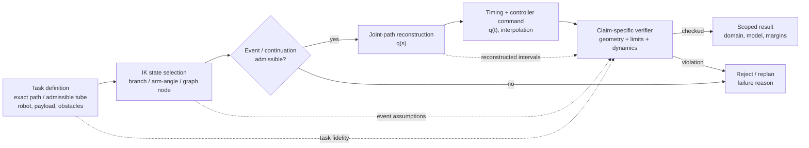

<!-- Gate 7-R8: structure and synthesis revision. The review remains a bounded, task-conditioned narrative synthesis; evidence limits and the unexecuted benchmark status are preserved. -->

# Trajectory-Consistent Inverse Kinematics for Fixed-Base Serial Manipulators: Branch Selection, Singularity Transitions, and Joint/Path Constraints

## Abstract

A sequence of valid inverse-kinematic (IK) solutions does not necessarily define a continuous, constraint-compliant joint trajectory along a prescribed Cartesian path. This structured, mechanism-oriented narrative review examines trajectory-consistent IK for fixed-base serial manipulators by relating solution representation, singularity and mode transition semantics, constraint domains, optimization or guarantee objects, and validation settings. An applicability-aware T1–T3 framework distinguishes path continuation and events (T1), constraint enforcement and its domain (T2), and verification of reconstructed motion (T3). The cross-study synthesis yields three bounded findings. First, path continuation, singularity or cuspidal mode transitions, and cyclic repeatability are distinct properties and should not be treated as interchangeable evidence. Second, meaningful combinations of IK selection and geometric or time-dependent constraints already exist, but their applicability depends on robot architecture, task tolerance, and the precise optimization object. Third, sampled feasibility, reconstructed-trajectory checks, and hardware execution establish different propositions and must be linked to the same realized motion before system-level claims are made. We propose a G0/G1/G2E/G2T common-task benchmark to separate exact geometric lifting, collision- and event-aware lifting, exact-path timed execution, and toleranced timed processes; the benchmark has not yet been executed. The review therefore contributes a task-conditioned comparison and reporting framework rather than a field-wide prevalence estimate or universal ranking of IK methods. Industrial reports should identify the task and tolerance, selected solution state and event rules, reconstruction and timing, checked constraints and verification domain, and the evidence actually obtained.

**Keywords:** trajectory-consistent inverse kinematics; solution-branch continuation; singularity transitions; constrained trajectory planning; trajectory verification; industrial manipulators

## 1. Introduction

For a fixed-base serial manipulator, a sequence of feasible end-effector poses does not uniquely specify how the joints should move between them. A robot may have different IK configurations for each pose, and a locally convenient choice can produce a discontinuity when carried along a process path. Obstacle geometry and actuator limits then impose additional conditions on the selected motion. These issues arise together in toolpath-following tasks, where the trajectory, not merely its endpoint, is part of the specification.

Let \(f:\mathcal Q\to\mathcal X\) be the forward-kinematics map and \(x:[0,1]\to\mathcal X\) a prescribed task-space path. An *exact geometric lift* is a continuous \(q:[0,1]\to\mathcal Q\) satisfying

\[
 f(q(s))=x(s),\qquad s\in[0,1].
\]

For a process with allowed task deviation, replace the equality by an explicit admissible set \(f(q(s))\in\mathcal X_{\mathrm{task}}(s)\). For time-dependent claims, a timing law \(s=s(t)\) and suitable differentiability or piecewise regularity are additionally required. When these derivatives exist,

\[
 \dot q(t)=q'(s)\dot s(t),\qquad
 \ddot q(t)=q''(s)\dot s(t)^2+q'(s)\ddot s(t),
\]

with velocities and accelerations interpreted on the smooth segments and with appropriate junction conditions. Torque and torque-rate calculations further require a dynamic model, payload, and operating assumptions. Continuity of \(q(s)\) alone supplies none of these higher-order guarantees.

Recent work makes different parts of this construction explicit. Analytical descriptions reveal IK solution structure (Hauser and Emmons, 2018; Gong et al., 2019). Pathwise graphs select compatible sampled configurations (Rakita et al., 2019; Wang et al., 2024; Elias and Wen, 2025). Geometry of cuspidal manipulators makes nonsingular solution mode changes possible under particular architectures (Wenger and Chablat, 2023; Salunkhe et al., 2025), whereas Boschi et al. (2026) construct transitions through selected singularities of UR-like robots. Finite-grid dynamic programming and constrained differential IK address distinct joint and dynamic bounds (Ferrentino et al., 2024; Zhang and Kikuuwe, 2026). Industrial toolpath optimization adds task-space tolerance, collision, and controller realization (Weingartshofer et al., 2023).

This review is a task-conditioned narrative synthesis focused on fixed-base serial manipulators, prescribed Cartesian paths, solution selection, singularity or mode events, geometric and time-dependent constraints, and verification of the realized motion. It is not designed to estimate field-wide method prevalence. Its contributions are a mechanism-oriented comparison, an applicability-aware synthesis of constraint and verification evidence, and a proposed common-task design for future evaluation.

## 2. Research Status and Mechanisms

### 2.1. Existing Reviews and Comparison Framework

Existing IK reviews offer complementary foundations for assessing fixed-base serial manipulators. Lakshmi Narayanan et al. (2026) organize a broad serial-manipulator literature around model-driven and data-driven solvers, limitations, and reported performance. Xing et al. (2026) relate analytical, numerical, optimization, and AI methods to redundancy resolution, task-priority strategies, and optimization objectives. Trullo and Vivas Alban (2025) systematically compare analytical, numerical, and learning-based IK approaches for fixed-base serial manipulators, emphasizing solution accuracy, response time, hybrid strategies, and method selection. Wenger and Chablat (2023) synthesize cuspidal-robot topology and nonsingular posture changes. Rudrasamudram and Malaichamee (2026), a non-peer-reviewed arXiv preprint, discuss formal versus empirical singularity-robustness evidence and present a position-only Panda comparison.

| Related synthesis | Established contribution | Question examined in the present review |
|---|---|---|
| Lakshmi Narayanan et al. (2026) | Serial IK solver families, evidence breadth, and comparative performance | How does a sequence of valid solutions become a specified continuous joint-path realization? |
| Xing et al. (2026) | Redundancy objectives, task priorities, constraint-aware optimization, and multiobjective methods | Are joint, collision, and dynamic claims made for compatible task specifications and verification domains? |
| Trullo and Vivas Alban (2025) | Analytical, numerical, learning-based, and hybrid solver comparison for fixed-base serial robots | How do solver-level accuracy and response-time results relate to pathwise selection, event handling, and trajectory verification? |
| Wenger and Chablat (2023) | Cuspidal topology and nonsingular mode change | Under which robot topologies can nonsingular mode changes be compared with prescribed singular crossings? |
| Rudrasamudram and Malaichamee (2026), preprint | Formal/empirical guarantee terminology and a position-only Panda comparison | How do evidence grades relate to full-pose task identity, reconstructed joint motion, and constraint verification? |

The present synthesis compares IK methods through five complementary axes and evaluates how their solution states, task specifications, reconstructed trajectories, and verification domains relate across studies. Its unit of comparison is the tuple of **robot architecture, task/path tolerance, selected solution state, reconstructed path, constraint and verification domain, and evidence depth**. This explains why a finite-graph optimum, an architecture-conditioned branch transition, and an optimization result within a toleranced process corridor need not be directly rankable, even when all support useful robotic tasks.

A comparison row refers to one reported method in one robot/task setting, not to a whole solver family. The five analytical axes below are coded independently.

A comparison row refers to **one reported method in one robot/task setting**, not to a whole solver family. The following axes can be coded independently:

| Axis | Observable coding question | Examples of non-equivalent objects |
|---|---|---|
| A1 — Solution-state representation | Is the chosen state an analytical branch, redundancy coordinate, sampled graph node, optimizer iterate or local differential state? | Multiple pose solutions versus a persistent pathwise selector |
| A2 — Singularity/mode response | Is a mode maintained, avoided, regularized, switched nonsingularly, or crossed at a defined singular event? | Cuspidal nonsingular mode change versus conditional UR-like singular switch |
| A3 — Constraint scope and enforcement | Which task, joint, derivative, torque and collision conditions are hard/soft, and where are they checked? | Node/edge inequalities versus a reconstructed continuous segment |
| A4 — Guarantee or optimization object | What has actually been established—existence, conditional law, finite optimum, feasibility for a discrete model, or interval statement? | Global optimality **on a finite graph** versus physical execution guarantee |
| A5 — Validation setting and evidence depth | Which analytic, simulation, robot-hardware and source-version evidence was examined? | One successful hardware task versus a platform-independent theorem |

| Dimension | Core question | Evidence object to keep distinct |
|---|---|---|
| **T1 — Path continuation and events** | What connected object is selected, and how are mode or singularity events handled? | Sample sequence, graph edge, analytical interval, or reconstructed joint curve |
| **T2 — Constraint enforcement and domain** | Which hard constraints and soft objectives are imposed, and where are they checked? | Nodes, edges, time steps, interpolation, or a bounded continuous interval |
| **T3 — Trajectory verification** | Is the same reconstructed motion checked for the claims being made? | Geometry, timing, dynamic limits, numerical checks, and hardware evidence |

T1–T3 are analysis dimensions, not validated numerical scores. Evidence states and source-depth conventions are defined in Supplementary S4.1. For an integrated exact or toleranced, collision-constrained, timed task, the relevant obligations attach to the composed planning-and-verification pipeline; they need not all apply to each component method. A solver is not treated as deficient merely because a different claim, such as torque certification, lies outside its stated objective.

### 2.2. Pathwise Solution Selection and Singularity Transitions

Analytical branch labels, redundancy coordinates, sampled graph nodes, optimizer iterates, and local differential states represent different solution objects. Architecture-specific analyses can identify distinct inverse-kinematic branches and the configurations at which those labels degenerate (Gong et al., 2019), while configuration-sheet and pseudoinverse constructions address assignment across a task workspace rather than a single pose query (Hauser and Emmons, 2018). Related work on global configuration control and pointwise optimization further shows that a “global IK” claim must be interpreted against its actual object: a pointwise optimum is not automatically a pathwise lift (Faria et al., 2018; Trutman et al., 2022).

Pathwise selection adds a coupling requirement between successive solutions. Sampled-graph methods such as STAMPEDE represent feasible configurations as nodes and admissible inter-layer motions as edges, then optimize among the paths represented in that finite graph (Rakita et al., 2019). Elias and Wen (2025) also use a graph of sampled IK solutions, making connectivity in cuspidal solution spaces relevant to candidate selection and workpiece-relative path placement. These methods do more than solve poses independently, but their discrete candidates and edges do not by themselves establish every property of an arbitrary continuous reconstruction. Other studies address cyclic return, whole-trajectory optimization, semi-constrained tool frames, or solution existence over a parameterized path (Safeea et al., 2021; Tringali and Cocuzza, 2020; Malhan et al., 2023; Dulęba and Karcz-Dulęba, 2018; Yoshizawa et al., 2023). Closed-path repeatability and existence at each path parameter remain distinct from ordinary continuity of one selected joint trajectory.

Singularity handling likewise comprises different mechanisms, not a single interchangeable strategy. Avoidance and numerical regularization can improve conditioning or preserve a nonsingular route when the task permits it (Colomé and Torras, 2012; Beck et al., 2023; Milenkovic et al., 2023). A nonsingular solution mode transition is possible for suitable cuspidal architectures, but depends on their topology and the path (Wenger and Chablat, 2023; Salunkhe et al., 2025; Elias and Wen, 2025). Tracking along a prescribed singular path addresses a different case: Miyata et al. (2017) describe a structure-specific construction, while the evidence assessed here does not include their complete mathematical proof. Boschi et al. (2026) explicitly address branch switching across selected singularities in UR-like robots under kinematic admissibility conditions. Milenkovic (2022) studies an offset-wrist path-reversal mechanism and should not be treated as the same event or guarantee as the UR-like transition.

The shared conclusion is that solution representation, pathwise selection, and singularity-event semantics must be stated separately. The appropriate method depends on whether the task can avoid rank loss, whether the architecture admits a nonsingular mode change, or whether a specified singular crossing is required; the sufficiency of sampled continuity claims is examined in Section 3.

### 2.3. Geometric, Dynamic, and Process Constraints

Constraint claims differ according to the variables constrained and the domain where feasibility is established. Joint-position limits can be included in geometric IK construction, whereas velocity, acceleration, jerk, torque, and torque-rate constraints depend on a timing law and modeling assumptions. Collision clearance concerns the occupied geometry of relevant links along the motion, not only end-effector poses. A hard inequality in an optimization model is distinct from a soft penalty, and neither automatically certifies the interpolated or physically executed trajectory.

Ferrentino et al. (2024) combine redundancy resolution with discretized trajectory-state decisions and joint, derivative, and torque-related limits. Their Panda experiments demonstrate the integrated planning approach, while the finite discretization and the paper’s own discussion of higher-order constraints bound the interpretation of global optimality. Zhang and Kikuuwe (2026) formulate a discrete-time viability construction for differential IK with modeled joint and collision inequalities; this supports feasibility reasoning for the stated discrete model, not an unmodeled continuous-time or actuator guarantee.

Manufacturing-oriented planning illustrates a different constraint domain. Weingartshofer et al. (2023) combine hard joint-position and collision inequalities with soft movement and clearance penalties, permit specified process deviations, reconstruct joint paths with cubic Hermite segments, and report an iiwa hardware drawing task and KR8 spraying simulation. The tolerance changes the admissible task set; the reconstruction and its verification determine which trajectory-level claims follow. Patkó and Zelei (2021) analyze velocity- and acceleration-level IK stability under stated discretization assumptions, while Li and Wang (2024) combine obstacle, singularity, and joint-limit avoidance but report tracking-error trade-offs. Zhang and Wang (2025), Oelerich et al. (2025; BoundPlanner), and other constrained approaches demonstrate useful integration of redundancy, collision handling, task-space freedom, or predictive control without making those task specifications interchangeable.

The constraint literature therefore supports neither a blanket claim that integration is absent nor a blanket claim that integrated planning guarantees continuous physical feasibility. Comparisons must identify whether a condition is hard or soft, the task set it applies to, and whether the verification domain is a sample, edge, interpolant, timed command, or validated interval. Section 3 develops the resulting methodological boundaries.

## 3. Key Methodological Controversies

### 3.1. Sampling Feasibility and Continuity Claims

Sampled feasibility and trajectory continuity are different claims. A graph can establish that its retained nodes are feasible and its represented edges satisfy the encoded transition rule; an optimum is then an optimum over that graph, not automatically over all continuous joint paths. STAMPEDE (Rakita et al., 2019) and the sampled graph of Elias and Wen (2025) illustrate the value of explicit edge selection, while also making candidate coverage and reconstruction assumptions central to interpretation.

The same distinction persists after interpolation. Weingartshofer et al. (2023) reconstruct optimized joint paths with piecewise cubic Hermite segments, so a trajectory-level collision or regularity claim must concern those segments rather than only the optimizer’s path samples. Likewise, discrete-time viability constraints (Zhang and Kikuuwe, 2026) and finite-grid dynamic programming (Ferrentino et al., 2024) are meaningful within their modeled domains but do not imply arbitrary inter-sample bounds without a corresponding check or sound bound. This is a domain distinction, not evidence that any cited method experienced a particular inter-sample failure.

Continuity also should not be used as a proxy for cyclic repeatability. Safeea et al. (2021) and Dulęba and Karcz-Dulęba (2018) address return behavior on closed Cartesian paths, which is a separate requirement from producing a continuous lift on an open path. Studies should therefore state whether their claim concerns sampled transition legality, a reconstructed continuous curve, an event-conditioned branch transition, or closed-path return.

### 3.2. Singularity Strategies and Task Specifications

The legitimate response to a singular configuration depends on the robot architecture and the task specification. Avoidance changes the feasible route when the assigned path intersects a forbidden region; regularization controls numerical behavior but does not itself establish that a prescribed branch transition is admissible. For suitable cuspidal manipulators, a nonsingular mode change may connect configurations without crossing a Jacobian singularity (Wenger and Chablat, 2023; Salunkhe et al., 2025). For a non-cuspidal UR-like robot, a required transition between uniqueness domains may instead involve crossing a singular configuration and selecting the post-event branch according to explicit kinematic conditions (Boschi et al., 2026).

Task freedom changes the comparison. Weingartshofer et al. (2023) allow specified manufacturing-process tolerances; Malhan et al. (2023) consider semi-constrained tool frames; Oelerich et al. (2025) use bounded Cartesian corridors; and Elias and Wen (2025) optimize workpiece-relative placement. These are not one generic tolerance model: orientation windows, path-error corridors, and rigid placement changes define different feasible sets. They should not be pooled with an exact fixed-frame Cartesian path or ranked as if they solved the same problem.

A defensible comparison must therefore declare the robot topology, exact or toleranced task, permitted event class, and event-admissibility rule before assessing success. A method that changes the task to avoid singularity may be appropriate for a toleranced process but does not establish feasibility of an unchanged exact path; conversely, singular crossing is not a universal replacement for avoidance.

### 3.3. Integration and Time-Parameterization Boundaries

Integration does not make evidence automatically compositional. If one module selects a branch or sampled path under model \(M_A\), another reconstructs or retimes it, and a verifier checks a changed trajectory under model \(M_C\), the first module’s guarantee and the verifier’s result support an end-to-end claim only if the relation between the checked objects and assumptions is established. A bounded approximation or robustness argument can justify transfer; literal identity is not required, but unreported changes to task, model, interpolation, or controller command cannot be ignored.

Geometric lifting, time parameterization, and physical execution answer different questions. A continuous geometric joint curve does not by itself establish velocity, acceleration, torque, or torque-rate feasibility; those require a timing law, model assumptions, and checks on the timed command. Similarly, collision clearance should be checked on the reconstructed link motion and stated obstacle model when that claim is made. This requirement does not mean every component paper must perform every verification: the obligation follows the system-level claim being asserted.

The evidence-object chain below makes these interfaces explicit. Solid arrows represent transformations of the motion; dashed arrows represent claim-to-object checks that should be reported when the corresponding guarantee is asserted.

**Figure 1 — Conceptual evidence-object chain.** Solid arrows depict data transformations; dashed arrows denote claim-to-object checks that must be reported for any corresponding system claim.

The chain identifies which transformed motion object and model assumptions must be supplied to the corresponding verifier.

## 4. Research Progress: Cross-study Synthesis

### 4.1. Cross-study Evidence Matrix

**Table 1A.** The matrix compares reported mechanisms and evidence in the named robot/task settings. It is a purposive mechanism sample, not a representative estimate of the field or a numerical method ranking. The cells retain a status label and a short descriptor; detailed source locators and source-depth limits are provided in Supplementary S2 and the coding rules in Supplementary S4.1.

| Case: author, year, robot/task | T1: continuation and events | T2: constraints and domain | T3: trajectory verification |
|---|---|---|---|
| **Rakita et al. (2019), STAMPEDE**, multiple manipulators | FINITE_RESOLUTION · sampled graph and legal edges | FINITE_RESOLUTION · graph-level motion/collision rules | NOT_ASSESSED · swept-path certificate absent |
| **Ferrentino et al. (2024)**, redundant Panda | CONDITIONAL · discretized trajectory-state planning | FINITE_RESOLUTION · joint and dynamic limits in DP | REPORTED · Panda hardware; interval bounds unassessed |
| **Elias and Wen (2025)**, cuspidal 6R path | CONDITIONAL · cuspidal graph connections | FINITE_RESOLUTION · graph/time edges; no collision task | NOT_ASSESSED · numerical examples; no hardware check |
| **Boschi et al. (2026)**, UR-like robots/UR5e | CONDITIONAL · singular-event branch switching | CONDITIONAL · kinematic event rule; no dynamic certificate | REPORTED · UR5e hardware and simulation |
| **Weingartshofer et al. (2023)**, iiwa drawing/KR8 spraying | REPORTED · optimized path permits specified singular passage | REPORTED · hard bounds plus soft penalties/tolerance | REPORTED · iiwa hardware and KR8 simulation |
| **Zhang and Kikuuwe (2026)**, discrete differential IK | NOT_APPLICABLE · no stated branch-event mechanism | FINITE_RESOLUTION · discrete joint/collision viability | FINITE_RESOLUTION · simulation; inter-step bounds unassessed |
| **Malhan et al. (2023)**, semi-constrained process path | FINITE_RESOLUTION · tool-frame configuration graph | CONDITIONAL · task-frame freedom and graph constraints | NOT_ASSESSED · numerical evaluation; hardware unassessed |
| **Oelerich et al. (2025), BoundPlanner**, 7-DOF | NOT_APPLICABLE · bounded-corridor predictive planning | REPORTED · corridor and collision-aware MPC | REPORTED · simulation and 7-DOF experiments |
| **Peidro and Haug (2024)**, redundant 6/23-joint models | CONDITIONAL · manifold continuation in regular domains | REPORTED · obstacle-aware configuration manifold | FINITE_RESOLUTION · numerical cases; hardware unassessed |
| **Malik et al. (2021)**, 7-DOF Sawyer | NOT_ASSESSED · sequential path; no branch proof | FINITE_RESOLUTION · weighted pose/effort/collision objective | REPORTED · Sawyer hardware; swept clearance unassessed |
| **Kelemen et al. (2018)**, planar 5R/20R and prototype | REPORTED · sequential DLS with avoidance | CONDITIONAL · weighted limits and obstacle terms | REPORTED · small 5R prototype; broad bounds unassessed |
| **Caballero-Mora et al. (2026)**, UR3 pose benchmarks | NOT_ASSESSED · pose trials; no path theorem | FINITE_RESOLUTION · conditioning penalty, not hard safety | REPORTED · RoboDK and selected UR3 tests |
| **Y. Zhang et al. (2026)**, FANUC M-20iA grinding simulation | FINITE_RESOLUTION · sampled pose graph and filtering | FINITE_RESOLUTION · GJK and joint/singularity filters | FINITE_RESOLUTION · FANUC simulation; sweep unassessed |

The table distinguishes a paper’s reported result from an unassessed proposition; NOT_ASSESSED does not mean failure, and hardware evidence does not imply a general theorem. Three 2026 near-neighbor sources are not matrix rows because the complete mathematical assumptions remain unassessed in this review. Zeng et al. (2026) report arm-angle continuity and finite-horizon velocity/acceleration retiming on a humanoid platform; M. Zhang et al. (2026) report arm-angle selection and kinematic boundary handling in publisher metadata or an abstract; Milenkovic et al. (2026) report singularity-related alternative IK paths in publisher abstract/highlights. These records are contextual evidence leads, not independently verified full-text cases, and do not support a claim of failure or field-wide prevalence.

### 4.2. Three Bounded Findings

**Finding F1 — Path continuation, singularity transitions, and cyclic repeatability are distinct properties.** STAMPEDE’s finite candidate graph (Rakita et al., 2019), the event-conditioned UR-like branch switch of Boschi et al. (2026), and the cuspidal solution connections of Elias and Wen (2025) address different path-lifting questions. Safeea et al. (2021) and Dulęba and Karcz-Dulęba (2018) additionally treat return on closed paths, which cannot be inferred from open-path continuity alone.

**Finding F2 — IK selection and constraint integration already exist, but task equivalence is essential.** Ferrentino et al. (2024) combine redundancy planning with discretized kinematic and dynamic bounds; Weingartshofer et al. (2023) integrate joint-path optimization, collision constraints, and process tolerance; and BoundPlanner (Oelerich et al., 2025) combines bounded Cartesian corridors with predictive collision handling. Their positive integrations should not be collapsed into one performance class because exact poses, toleranced process paths, and bounded corridors define different feasible sets.

**Finding F3 — Constraint enforcement and trajectory-verification evidence must be interpreted by domain.** A legal graph edge (Rakita et al., 2019), a hard inequality with Hermite reconstruction and hardware evidence (Weingartshofer et al., 2023), a discrete viability model (Zhang and Kikuuwe, 2026), and finite-grid planning with Panda hardware experiments (Ferrentino et al., 2024) establish different propositions. System-level claims therefore require the checked constraints, reconstruction, timing, model, and verification domain to be linked to the same realized motion; the reviewed evidence does not establish that the cited methods experienced inter-sample failure.

## 5. Future Outlook

### 5.1. Proposed G0/G1/G2E/G2T Benchmark

The proposed common-task benchmark separates G0 exact geometric lifting, G1 collision- and event-aware lifting, G2E exact-path timed execution, and G2T timed execution inside a separately specified task-tolerance tube. These levels progressively expose path/event selection, constraint enforcement, and verification of the reconstructed and timed motion; their T1–T3 relationship and evidence labels are summarized in Supplementary S4.1. The complete task dossier, execution protocol, stopping rules, and outcome semantics are in Supplementary S5. This benchmark is a proposed design and has not been executed.

### 5.2. Research Requirements: Events, Trajectory Verification, and Fair Comparison

Future studies should first specify the incoming and outgoing solution state, event admissibility, and regularity expected at each singularity or mode transition; this event record defines which joint path must then be reconstructed. Verification should apply to that actual reconstruction and, where claimed, its timed controller command, with the robot model, link pairs, numerical resolution or sound interval bounds, and dynamic extrema stated explicitly. Fair comparison follows from these two requirements: methods should be tested on the same robot/task dossier or on clearly separated exact-path, toleranced-path, and free-placement variants, with structural mismatches marked NOT_APPLICABLE rather than treated as failure.

### 5.3. Minimum Reporting Conventions and Verification Priorities

| Capability claimed | Minimum information needed for interpretation or reproduction |
|---|---|
| Pathwise IK selection | Robot/DOF, exact or toleranced task, initial state, solution representation, sampling and reconstruction, task residual |
| Branch or singularity event | Event type, architecture preconditions, pre/post state, admissibility rule, junction regularity, abort response |
| Collision-constrained motion | Hard inequality versus penalty, geometry and collision-pair policy, verification domain, margin and resolution |
| Timed dynamic feasibility | Timing law, controller interpolation/resampling, payload/model, derivative and torque limits, checked extrema |
| Hardware validation | Robot and calibration, controller settings, planned versus measured motion, tracking error and abort record |
| Evidence provenance | Source version and depth, theorem/simulation/hardware status, and NOT_APPLICABLE versus NOT_ASSESSED |

These are reporting recommendations illustrated by the reviewed cases, not a validated standard or an experimentally verified scoring rubric. Immediate verification priorities are the full mathematical assumptions and experiment settings of Zeng et al. (2026), M. Zhang et al. (2026), and Milenkovic et al. (2026), along with selected records flagged by the historical 62-record triage when a future generalization depends on them. Broader database-native retrieval, citation chaining, shared-robot tests, and independent coding-agreement assessment would be needed to test the reproducibility and discriminative value of the proposed reporting framework.

## 6. Methodological Note and Conclusion

### 6.1. Methodological Note and Limitations

This is a structured, mechanism-oriented narrative synthesis, not an exhaustive systematic review. The focused TCIK discovery comprised one exploratory Consensus Pro query and 16 recorded Consensus Quick queries on 29 September 2026. The RIS exports contained 419 record instances, normalized to 179 DOI-unique records. Historical screening classified 30 as CORE_INCLUDE, 74 as ADJACENT, 57 as EXCLUDE, and 18 as UNCERTAIN_FULLTEXT; thus 104 records were retained in the working bibliography. The reading log records 87 READ_COMPLETE and 17 PAYWALLED_OR_UNAVAILABLE among those 104. Abstract metadata flags (161 AVAILABLE and 18 MISSING) are a separate variable and do not map one-to-one onto screening dispositions.

A bounded public-web update on 11 October 2026 used four focused query groups and identified relevant 2026 publications absent from the original 179 DOI records. The *Machines* publisher HTML for Y. Zhang et al. was consulted; the complete mathematical assumptions of Zeng et al., M. Zhang et al., and Milenkovic et al. remain NOT_ASSESSED in this review. This update was not an authenticated Scopus, Web of Science, or database-native IEEE Xplore retrieval. The older uncertainty-aware planning corpus (306 search-hit occurrences and 226 deduplicated titles) addressed a different research question and is not an upstream denominator for this IK-focused review.

The comparison matrix is a purposive mechanism sample. A rapid claim-impact triage of 62 historically read records that were uncited at the R5 baseline identified four initial matrix candidates, one related-review overlap, 13 further verification priorities, and 44 contextual or lower-priority records; it did not constitute independent full-text reassessment of all 62. The bibliography contains 50 DOI-bearing references, but the cited sources differ in evidence depth. No exhaustive citation chaining, independent full-text verification of every source, or inter-rater coding study was conducted. Detailed source provenance, historical screening cross-tabs, version boundaries, and reading/access states are preserved in Supplementary S1–S2. The proposed G0/G1/G2E/G2T benchmark has not been executed; no common-task performance comparison is reported.

**Data availability.** The associated project repository retains the search protocol and logs, screening records, reading/access log, source-locator material, and historical triage data. This manuscript does not claim that these project materials are publicly accessible; the relevant provenance and access limitations are documented in Supplementary S1.

### 6.2. Conclusion

For industrial path planning, a result should be reported as a linked claim about a specified task, selected IK solution, reconstructed joint motion, timing and controller command where relevant, and the verification domain actually examined. This prevents a finite graph optimum, a conditional singularity transition, and a toleranced process solution from being treated as interchangeable evidence.

The next step is not another universal ranking of solver families, but shared task specifications and claim-matched verification that can test whether planning, reconstruction, and checking refer to compatible motion objects. Open questions include how to certify inter-sample constraints efficiently, how to compare architecture-specific event rules fairly, and how reproducible the proposed coding and reporting conventions are across independently assessed studies.

## References

Beck, F., Vu, M. N., Hartl-Nesic, C. and Kugi, A. (2023). Singularity avoidance with application to online trajectory optimization for serial manipulators. *IFAC-PapersOnLine*, 56(2), 284–291. https://doi.org/10.1016/j.ifacol.2023.10.1582

Boschi, I., De Toni, A., Di Leva, R., Ida, E. and Carricato, M. (2026). Handling transitions across singularities for UR-like serial robots. *IEEE Robotics and Automation Letters*, 11(3), 2714–2721. https://doi.org/10.1109/LRA.2026.3653295

Caballero-Mora, J. A., Sanin-Villa, D., Girón-Nieto, H., Botero-Gómez, V., Portillo-Vélez, R. J., López-Romero, J. C. and Tejada, J. C. (2026). UR3 collaborative robot inverse kinematics using metaheuristic optimization: A unified comparative and experimental evaluation. *Applied System Innovation*, 9(7), 140. https://doi.org/10.3390/asi9070140

Colomé, A. and Torras, C. (2012). Redundant inverse kinematics: Experimental comparative review and two enhancements. In *2012 IEEE/RSJ International Conference on Intelligent Robots and Systems*, 5333–5340. https://doi.org/10.1109/IROS.2012.6385672

Donelan, P. S. (2007). Singularity-theoretic methods in robot kinematics. *Robotica*, 25(6), 641–659. https://doi.org/10.1017/S0263574707003748

Dulęba, I. and Karcz-Dulęba, I. (2018). A comparison of methods solving repeatable inverse kinematics for robot manipulators. *Archives of Control Sciences*, 28(1), 5–18. https://doi.org/10.24425/119074

Dulęba, I. and Karcz-Dulęba, I. (2023). Many faces of singularities in robotics. *Pomiary Automatyka Robotyka*, 27(1), 19–26. https://doi.org/10.14313/par_247/19

Elias, A. J. and Wen, J. T. (2025). Path planning and optimization for cuspidal 6R manipulators. *Journal of Mechanisms and Robotics*, 17(12), 121008. https://doi.org/10.1115/1.4069599

Faria, C., Ferreira, F., Erlhagen, W., Monteiro, S. and Bicho, E. (2018). Position-based kinematics for 7-DoF serial manipulators with global configuration control, joint limit and singularity avoidance. *Mechanism and Machine Theory*, 121, 317–334. https://doi.org/10.1016/j.mechmachtheory.2017.10.025

Faroni, M., Beschi, M. and Pedrocchi, N. (2020). Inverse kinematics of redundant manipulators with dynamic bounds on joint movements. *IEEE Robotics and Automation Letters*, 5(4), 6435–6442. https://doi.org/10.1109/LRA.2020.3013879

Ferrentino, E., Savino, H. J., Franchi, A. and Chiacchio, P. (2024). A dynamic programming framework for optimal planning of redundant robots along prescribed paths with kineto-dynamic constraints. *IEEE Transactions on Automation Science and Engineering*, 21(4), 6744–6757. https://doi.org/10.1109/TASE.2023.3330371

Gong, M., Li, X. and Zhang, L. (2019). Analytical inverse kinematics and self-motion application for 7-DOF redundant manipulator. *IEEE Access*, 7, 18662–18674. https://doi.org/10.1109/ACCESS.2019.2895741

Hauser, K. and Emmons, S. (2018). Global redundancy resolution via continuous pseudoinversion of the forward kinematic map. *IEEE Transactions on Automation Science and Engineering*, 15(3), 932–944. https://doi.org/10.1109/TASE.2018.2805878

Kelemen, M., Virgala, I., Lipták, T., Miková, Ľ., Filakovský, F. and Bulej, V. (2018). A novel approach for a inverse kinematics solution of a redundant manipulator. *Applied Sciences*, 8(11), 2229. https://doi.org/10.3390/app8112229

Kieffer, J. (1992). Manipulator inverse kinematics for untimed end-effector trajectories with ordinary singularities. *The International Journal of Robotics Research*, 11(3), 225–237. https://doi.org/10.1177/027836499201100305

Lakshmi Narayanan, V., Narayan, J., Gritli, H. and Dwivedy, S. K. (2026). A decade of inverse kinematics methods for serial manipulators: A systematic review. *Journal of Field Robotics*, 43(1), 184–229. https://doi.org/10.1002/rob.70014

Li, Y. and Wang, L. (2024). Comprehensive research and analysis on obstacle–singularity–joint limit avoidance of redundant robot. *International Journal of Advanced Robotic Systems*, 21(1). https://doi.org/10.1177/17298806241233910

Malhan, R. K., Thakar, S., Kabir, A. M., Rajendran, P., Bhatt, P. M. and Gupta, S. K. (2023). Generation of configuration space trajectories over semi-constrained Cartesian paths for robotic manipulators. *IEEE Transactions on Automation Science and Engineering*, 20(1), 193–205. https://doi.org/10.1109/TASE.2022.3144673

Malik, A., Henderson, T. and Prazenica, R. (2021). Multi-objective swarm intelligence trajectory generation for a 7 degree of freedom robotic manipulator. *Robotics*, 10(4), 127. https://doi.org/10.3390/robotics10040127

Milenkovic, P. (2022). Optimal path crossing the orientation exclusion zone of a robot with offset wrist. *Robotica*, 40(1), 191–212. https://doi.org/10.1017/S0263574721000461

Milenkovic, P., Wang, Z. and Rodriguez, J. I. (2023). Encountering singularities of a serial robot along continuous paths at high precision. *Mechanism and Machine Theory*, 181, 105224. https://doi.org/10.1016/j.mechmachtheory.2022.105224

Milenkovic, P., Wang, Z. and Rodriguez, J. I. (2026). Encircling singularities of a serial robot to find alternative inverse-kinematic solutions. *Mechanism and Machine Theory*, 219, 106314. https://doi.org/10.1016/j.mechmachtheory.2025.106314

Miyata, S., Miyahara, S. and Nenchev, D. (2017). Analytical formula for the pseudoinverse and its application for singular path tracking with a class of redundant robotic limbs. *Advanced Robotics*, 31(10), 509–518. https://doi.org/10.1080/01691864.2017.1285721

Müller, A. (2004). Collision avoiding continuation method for the inverse kinematics of redundant manipulators. In *Proceedings of the 2004 IEEE International Conference on Robotics and Automation*, 1593–1598. https://doi.org/10.1109/ROBOT.2004.1308051

Nguyen, D. T., Nguyen, V. T. T., Do, T. and Nguyen, V. L. (2026). Multi-solution inverse kinematics for robotic manipulators via permutation-invariant set prediction. *IEEE Robotics and Automation Letters*, 11(8), 9803–9810. https://doi.org/10.1109/LRA.2026.3703280

Oelerich, T., Beck, F., Hartl-Nesic, C. and Kugi, A. (2025). BoundMPC: Cartesian path following with error bounds based on model predictive control in the joint space. *The International Journal of Robotics Research*, 44(8), 1287–1316. https://doi.org/10.1177/02783649241309354

Oelerich, T., Hartl-Nesic, C., Beck, F. and Kugi, A. (2025). BoundPlanner: A convex-set-based approach to bounded manipulator trajectory planning. *IEEE Robotics and Automation Letters*, 10(6), 5393–5400. https://doi.org/10.1109/LRA.2025.3558450

Patkó, D. and Zelei, A. (2021). Velocity and acceleration level inverse kinematic calculation alternatives for redundant manipulators. *Meccanica*, 56, 887–900. https://doi.org/10.1007/s11012-020-01305-z

Peidro, A. and Haug, E. J. (2024). Obstacle avoidance in operational configuration space kinematic control of redundant serial manipulators. *Machines*, 12(1), 10. https://doi.org/10.3390/machines12010010

Rakita, D., Mutlu, B. and Gleicher, M. (2019). STAMPEDE: A discrete-optimization method for solving pathwise-inverse kinematics. In *2019 International Conference on Robotics and Automation (ICRA)*, 3507–3513. https://doi.org/10.1109/ICRA.2019.8793617

Reinhold, J., Baumann, H. and Meurer, T. (2023). Constrained-differential-kinematics-decomposition-based NMPC for online manipulator control with low computational costs. *Robotics*, 12(1), 7. https://doi.org/10.3390/robotics12010007

Reiter, A., Mueller, A. and Gattringer, H. (2018). On higher order inverse kinematics methods in time-optimal trajectory planning for kinematically redundant manipulators. *IEEE Transactions on Industrial Informatics*, 14(4), 1681–1690. https://doi.org/10.1109/TII.2018.2792002

Rudrasamudram, V. and Malaichamee, H. (2026). Singularity avoidance in inverse kinematics: A unified treatment of classical and learning-based methods. *arXiv preprint* arXiv:2604.13405 [not peer-reviewed]. https://doi.org/10.48550/arXiv.2604.13405

Safeea, M., Bearee, R. and Neto, P. (2021). A modified DLS scheme with controlled cyclic solution for inverse kinematics in redundant robots. *IEEE Transactions on Industrial Informatics*, 17(12), 8014–8023. https://doi.org/10.1109/TII.2021.3060019

Salunkhe, D. H., Marauli, T., Müller, A., Chablat, D. and Wenger, P. (2025). Kinematic issues in 6R cuspidal robots, guidelines for path planning and deciding cuspidality. *The International Journal of Robotics Research*, 44(6), 1035–1054. https://doi.org/10.1177/02783649241293481

Tringali, A. and Cocuzza, S. (2020). Globally optimal inverse kinematics method for a redundant robot manipulator with linear and nonlinear constraints. *Robotics*, 9(3), 61. https://doi.org/10.3390/robotics9030061

Trullo, H. D. and Vivas Alban, O. A. (2025). A systematic review of inverse kinematics methods for fixed-base serial manipulators: Analytical, numerical, and machine learning methods. *International Journal of Robotics and Control Systems*, 5(3), 1808–1827. https://doi.org/10.31763/ijrcs.v5i3.1820

Trutman, P., Safey El Din, M., Henrion, D. and Pajdla, T. (2022). Globally optimal solution to inverse kinematics of 7DOF serial manipulator. *IEEE Robotics and Automation Letters*, 7(3), 6012–6019. https://doi.org/10.1109/LRA.2022.3163444

Wang, Y., Sifferman, C. and Gleicher, M. (2024). IKLink: End-effector trajectory tracking with minimal reconfigurations. In *2024 IEEE International Conference on Robotics and Automation (ICRA)*, 12165–12171. https://doi.org/10.1109/ICRA57147.2024.10611510

Weingartshofer, T., Bischof, B., Meiringer, M., Hartl-Nesic, C. and Kugi, A. (2023). Optimization-based path planning framework for industrial manufacturing processes with complex continuous paths. *Robotics and Computer-Integrated Manufacturing*, 82, 102516. https://doi.org/10.1016/j.rcim.2022.102516

Wenger, P. and Chablat, D. (2023). A review of cuspidal serial and parallel manipulators. *Journal of Mechanisms and Robotics*, 15(4), 040801. https://doi.org/10.1115/1.4055677

Xing, H., Huang, R., Yang, Y., Chen, J., Li, W., Yao, C., Shi, C. and Ding, L. (2026). Inverse kinematics and redundancy resolution in manipulators: Methods, optimization objectives, and future trends. *Biomimetic Intelligence and Robotics*, 6(2), 100339. https://doi.org/10.1016/j.birob.2026.100339

Yin, Z., Wu, F., Wang, Z., Yang, J., Tan, J. and Kong, D. (2025). Dynamic programming-based offline redundancy resolution of redundant manipulators along prescribed paths with real-time adjustment. *arXiv preprint* arXiv:2411.17052v2. https://doi.org/10.48550/arXiv.2411.17052

Yoshizawa, M., Terui, A. and Mikawa, M. (2023). Inverse kinematics and path planning of manipulator using real quantifier elimination based on Comprehensive Gröbner Systems. *arXiv preprint* arXiv:2305.12451. https://doi.org/10.48550/arXiv.2305.12451

Zeng, Z., Guo, J., Chen, J., Li, Y., Peng, S. and Pan, Y. (2026). Reliable 7-DOF manipulator execution via arm-angle selection and trajectory retiming. *IEEE Robotics and Automation Letters*, 11(11), 12919–12926. https://doi.org/10.1109/LRA.2026.3732902

Zhang, L., Du, H., Qin, Z., Zhao, Y.-J. and Yang, G. (2024). Real-time optimized inverse kinematics of redundant robots under inequality constraints. *Scientific Reports*, 14, 29754. https://doi.org/10.1038/s41598-024-81174-8

Zhang, M., Mei, S., He, H., Han, X. and Li, Z. (2026). Analytical inverse kinematics solution and global arm angle optimization method for 7-DOF redundant robotic arms without offset. *ISA Transactions*, 173, 425–436. https://doi.org/10.1016/j.isatra.2026.03.028

Zhang, Y. and Kikuuwe, R. (2026). Ensuring viability: A QP-based inverse kinematics for handling joint range, velocity and acceleration limits, as well as whole-body collision avoidance. *Journal of Intelligent & Robotic Systems*, 112(1), 16. https://doi.org/10.1007/s10846-025-02335-z

Zhang, Y. and Wang, H. (2025). Redundancy-based motion planning with task constraints for robot manipulators. *Sensors*, 25(6), 1900. https://doi.org/10.3390/s25061900

Zhang, Y., Xiao, Q., Wan, L. and Jiang, B. (2026). Collision-free robot pose optimization method based on improved algorithms. *Machines*, 14(1), 65. https://doi.org/10.3390/machines14010065

## Supplementary Note S1. Search Provenance, Screening Units, and Evidence Limitations

### S1.1. Search Methods and Inclusion Scope

The old **uncertainty-aware industrial trajectory-planning** Gate 1 ledger (`Satoru-1006/sci-review-gate1-uncertainty-aware-planning/SCREENING_LEDGER.csv`) has **226 records** (historically reported 306 source occurrences), with 36 `INCLUDE_FOR_FULLTEXT`, 46 `UNCERTAIN_FULLTEXT_REQUIRED`, 136 `EXCLUDE`, and eight `ABSTRACT_PENDING`. These decisions addressed an earlier, broader uncertainty-aware planning topic. They are **not** the source-count flow of the final IK-focused review and must not be mathematically subtracted from, combined with, or used to represent the later TCIK corpus.

The later **TCIK-specific** source is the separate frozen repository `Satoru-1006/trajectory-consistent-ik-literature-review`, anchored to `SEARCH_PROTOCOL.md` and 16 Quick searches in `SEARCH_LOG.csv` dated **2026-09-29**. The protocol's substantive focus is fixed-base serial manipulators, prescribed pathwise IK, branch/solution continuity, singularity events, and joint constraints.

| TCIK stage | Count | Unit and qualification |
|---|---:|---|
| Consensus Pro research-mode seeding | 1 exploratory query | Its visible estimated eligible count is not an exported record count |
| Consensus Quick C01–C16 RIS exports | **419** | Export **instances**, including within-query repeat exports and duplicates |
| DOI-normalized deduplicated records | **179** | Unique DOI-bearing records; title/abstract screen denominator |
| Abstract metadata AVAILABLE / MISSING | **161 / 18** | OpenAlex field flags; not identical to uncertain screening decisions |
| CORE_INCLUDE / ADJACENT | **30 / 74** | **104** screened-in, topic-specific working bibliography records |
| EXCLUDE / UNCERTAIN_FULLTEXT | **57 / 18** | The latter 18 are outside the 104; five have AVAILABLE abstract flags |
| Full-text READ_COMPLETE / PAYWALLED_OR_UNAVAILABLE | **87 / 17** | Statuses **within** the 104; no `NOT_STARTED` remain in the latest reading log |

The `exports/corpus_summary.json` in the frozen screening package reflects an **earlier interim full-text count**; final 87/17 full-text statuses should be taken from the later dated `FULLTEXT_READING_LOG.csv` and its 2026-10-03 README reconciliation rather than interpreted as an inconsistency in title/abstract selection. Search terms, export counts, provenance strings, DOI normalization, abstract status, and decision rationale are traceable in the named TCIK artifacts. There is no claim of exhaustive multi-database search saturation or full formal systematic-review screening.

**Search reproducibility and unresolved history.**

The **final research question now has its own documented search protocol, dated search log, exported source set, DOI-specific screening decisions, and reading statuses**. It no longer depends on the earlier uncertainty-planning ledger for identification of its IK literature base. However, the six-case purposeful selection and the additional in-window citations do not amount to a retrospectively reproducible, fully exhaustive search of every eligible study. The original paths by which the four in-window supplements were initially discovered are not available as complete query-level logs. The 18 abstract-status MISSING entries and the 18 UNCERTAIN_FULLTEXT decisions are overlapping but **nonidentical** groups; neither is the same as the 17 included records lacking article bodies. None is recast as a verified exclusion or a negative result about the field.

**Bounded public-web search update (11 October 2026).**

**Execution and scope.** On **2026-10-11**, four focused, human-readable literature queries were executed through a **public web search index**, with publisher, IEEE Xplore and other academic landing pages inspected where indexed content was available. These were not authenticated database-native exports. The searchable topic groups were: **S01** solution-branch/pathwise tracking; **S02** singularity crossing and bifurcation; **S03** constrained differential IK, arm angle and retiming; and **S04** graph/constraint-aware path construction. The executed query texts, source links, classification and claim-impact notes are preserved in `TARGETED_SEARCH_UPDATE.csv`. Results are a purposively recorded set of impact-relevant candidates, **not a complete retrieval count or statistically representative source pool**. Publisher pages were sometimes accessible only through indexed excerpts. No new paper was counted as FULLTEXT_VERIFIED.

**DOI comparison.** The new candidate DOIs `10.1016/j.mechmachtheory.2025.106314` (Milenkovic, Wang and Rodriguez, 2026), `10.1109/LRA.2026.3732902` (Zeng et al., 2026), `10.1016/j.isatra.2026.03.028` (Zhang et al., 2026), `10.3390/machines14010065` (2026 collision-free posture-graph optimization), and `10.1109/ICRA57385.2026.11696479` (2026 viability-preserving torque control) are **absent from the original 179 DOI-unique TCIK rows**. That absence records non-membership in the 2026-09-29 set, not proof of a defective original decision; some works were indexed/published later. In contrast `10.1109/LRA.2026.3653295` (Boschi et al.) and `10.1007/s10846-025-02335-z` (Zhang and Kikuuwe) are already present. No earlier decisions were silently rewritten.

**Preliminary impact appraisal (publisher metadata/abstracts, and selected open Machines article sections; NOT a complete five-paper full-text audit or final eligibility).**
- **S02:** Milenkovic et al. (2026) explicitly discuss alternative IK solutions reached by singularity-related continuous paths, potentially sharpening the branch-transition and topology discussion (T1). No demonstration of collision/dynamic feasibility or whole-path certification is inferred from the accessed record.
- **S03:** Zeng et al. (2026) combine interval-based arm-angle continuity under joint limits with finite-horizon velocity/acceleration retiming (T1/T2). Because the abstract reports experiments on a humanoid platform, transfer and eligibility for a fixed-base industrial-serial scope require full-text inspection. Its reported success rate is not transplanted as a field-wide guarantee.
- **S03:** Zhang et al. (2026, *ISA Transactions*, DOI `10.1016/j.isatra.2026.03.028`) report arm-angle selection and trajectory kinematic limits (T1/T2); validation domain and formal guarantee strength remain uncertain without full text.
- **S04:** *Collision-Free Robot Pose Optimization Method Based on Improved Algorithms* (2026, DOI 10.3390/machines14010065) is a close **graph-plus-constraints** comparator. Publisher Section 3.1 describes discretized path-point graph nodes filtered for joint bounds, manipulability and GJK collisions, and Section 4 reports FANUC M-20iA simulations. This is positive evidence of that combination at the reported sampled/planned domain, **not a separately established continuous swept-path guarantee**.
- **S03 contextual:** *Viability-Preserving Passive Torque Control* (ICRA 2026, DOI `10.1109/ICRA57385.2026.11696479`) concerns constrained torque control and modeled viable sets, not itself evidence for a branch-tracking IK method. It is adjacent benchmark/verification context, not a new IK core paper.

**Consequence.** The revised synthesis avoids any claim that no integrated T1/T2 methodology exists. Its six-case comparison is a **bounded mechanism sample**; T1/T2 integration is positively reported by near neighbors, while a claimed **field-wide absence** of any system satisfying the applicable T1/T2/T3 obligations on a common verified continuous domain remains **UNVERIFIED** without full-text appraisal of these candidates and a reproducible multi-database search. This public-web update is recorded as executed, whereas Scopus/Web of Science systematic coverage, database-native IEEE export, complete citation chasing, and independent full-text screening of additions remain **NOT_DONE**.

**Historical-source reconciliation.** Direct recount of the earlier project's `SCREENING_LEDGER.csv` found 226 unique record IDs whose `raw_hit_count` sum is 306. Direct recount of the separate TCIK `exports/records_raw.csv`, `exports/records_deduplicated.csv`, `SCREENING.csv`, and `FULLTEXT_READING_LOG.csv` found 419 instances, 179 DOI-unique records, 30/74/57/18 dispositions, and 87/17 full-text statuses. The 104 retained DOIs **and normalized titles** match the full-text log one-to-one. These two flows are separate, not a 306→226→104→87 funnel. Source and counting limitations are documented in `SEARCH_PROVENANCE_RECONCILIATION.md`.

### S1.2. Evidence Extraction, Citation Reconciliation, and Limitations

The frozen original 179-row TCIK SCREENING.csv is unchanged. R4 contained 40 DOI-identified references, 28 matched to the original 179 and 12 outside, with 21 historically READ_COMPLETE entries cited. R5 adds four already READ_COMPLETE studies: Dulęba and Karcz-Dulęba (2018), Yoshizawa et al. (2023), Zhang and Wang (2025), and Oelerich et al. (2025; *BoundPlanner*). These were not discovered through a claimed new systematic search. At the **R5 baseline**, the bibliography contained **44 unique DOI references: 32 matched to the original 179 and 12 external**. At that baseline, **25 of 87** historical READ_COMPLETE records were cited and **62** remained uncited; later R6/R7 changes are accounted for in Section 7.

Historical screening dispositions, subsequent relevance assessments and verified source depths are distinct. The six anchors remain purposive examples. The original outside-corpus anchors (STAMPEDE, Elias–Wen, Weingartshofer) have not been silently backfilled into the 104. Four additional 2026 near-neighbor DOIs remain outside the frozen 179. No unperformed full 179-row rescreen is represented as completed.

**Post-hoc screening cross-tab and targeted correction queue (11 October 2026).**

The frozen SCREENING.csv has 179 rows. Screening dispositions and abstract metadata are separate columns, with the following independently recounted cross-tabulation:

| Abstract flag / Screening decision | CORE_INCLUDE | ADJACENT | EXCLUDE | UNCERTAIN_FULLTEXT | Total |
|---|---:|---:|---:|---:|---:|
| AVAILABLE | 30 | 74 | 52 | 5 | **161** |
| MISSING | 0 | 0 | 5 | 13 | **18** |
| **Total** | **30** | **74** | **57** | **18** | **179** |

The five **AVAILABLE + UNCERTAIN_FULLTEXT** records retain stale decision rationales that say no abstract was available. Four carry meaningful text and one is only a graphical-abstract label:

| DOI | Available evidence and status correction | Action, not a final eligibility decision |
|---|---|---|
| [10.1080/01691864.2017.1285721](https://doi.org/10.1080/01691864.2017.1285721) | The field says only “Graphical Abstract”; **no usable prose abstract verified** | Keep uncertain; obtain readable abstract or full text |
| [10.1017/S0263574721000461](https://doi.org/10.1017/S0263574721000461) | Substantive offset-wrist singular-path-crossing abstract; publisher record found | Re-screen under T1; prior no-abstract rationale incorrect |
| [10.1007/s11012-020-01305-z](https://doi.org/10.1007/s11012-020-01305-z) | Substantive velocity/acceleration-level serial-manipulator IK abstract | Re-screen for constrained differential-IK relevance |
| [10.1177/17298806241233910](https://doi.org/10.1177/17298806241233910) | Substantive obstacle/singularity/joint-limit-avoidance abstract | Re-screen; avoid equating avoidance with crossing |
| [10.3390/robotics13060091](https://doi.org/10.3390/robotics13060091) | Substantive FANUC CRX 6R IK/solution-set abstract | Re-screen to distinguish pose-level IK from pathwise selection |

Of five **MISSING + EXCLUDE** records, four have an apparently reasonable **title-level platform mismatch**: a five-axis hybrid robot (DOI 10.1016/j.rcim.2018.06.003), a pneumatic continuum manipulator (10.1007/978-981-16-1769-0_1), a dual-arm space robot (10.1016/j.actaastro.2022.03.024), and a parallel robot (10.1016/j.mechmachtheory.2024.105865). Their recorded rationales should reference title-based **architecture/scope exclusions** rather than falsely imply abstract-based evidence about method absence. The fifth, *Geometry Based Analysis of 3R Serial Robots* ([10.1007/978-3-031-08140-8_8](https://doi.org/10.1007/978-3-031-08140-8_8)), is a serial-robot title; absence of trajectory-level relevance cannot be established from its title alone and **RE_SCREEN_REQUIRED** is the defensible action.

These ten exception annotations repair the **manuscript's evidence-state interpretation**; they do **not** silently rewrite the frozen 179 historical decisions. Formal re-screening outcome counts remain **NOT_ASSESSED**, pending saved DOI-specific decisions. This distinction prevents mixing an auditable correction queue with an unperformed screening round.

**Reading-to-claim audit.** Among 104 retained DOIs there are 87 READ_COMPLETE and 17 PAYWALLED_OR_UNAVAILABLE. Under R3's 28-reference bibliography 17 READ_COMPLETE entries were cited; R4 cited 21 and left 66 uncited; R5 now cites 25 and leaves **62**. Historical flags and current post-hoc scientific relevance assessments are distinct. Their logging does not prove that all their mechanisms entered the synthesis. The evidence-promoting rule is source-specific: record the method, assumptions, mathematical/verification domain, validation type and exact support for each major claim before using a source to support, contradict, or generalize a conclusion.

**Historical targeted screening correction and 2026 full-text impact boundary.**

**Separate evidence/decision layers.** Original `SCREENING.csv` decisions remain a dated historical ledger; this R4 correction **does not** overwrite them. The following judgments are **post-hoc provisional topic-aligned dispositions**, not an independent 179-record prospective screen, and were applied to the frozen fixed-base serial pathwise-IK review question. Full-text inspected indicates accessible publisher HTML with substantial article content, not independently reproduced experiments or full equation-by-equation mathematical proof.

| Historical DOI | Historical state | R4 provisional disposition | Evidence actually inspected | Claim consequence |
|---|---|---|---|---|
| 10.1080/01691864.2017.1285721, Miyata et al. (2017) | UNCERTAIN_FULLTEXT | CORE_CANDIDATE | Journal listing / indexed abstract, **not entire article** | Direct singular-path pseudoinverse tracking; full proof assumptions remain UNVERIFIED |
| 10.1017/S0263574721000461, Milenkovic (2022) | UNCERTAIN_FULLTEXT | CORE_CANDIDATE | Cambridge published abstract/metadata, **full PDF not independently read here** | Offset-wrist turning-point mechanism, not interchangeable with UR-like event index |
| 10.1007/s11012-020-01305-z, Patkó and Zelei (2021) | UNCERTAIN_FULLTEXT | ADJACENT_METHOD | Springer full published HTML, including stability and conclusion | Velocity/acceleration IK stability does not establish branch/swept-path safety |
| 10.1177/17298806241233910, Li and Wang (2024) | UNCERTAIN_FULLTEXT | CORE_CANDIDATE | SAGE full published HTML, including methodology, figures and limitations | Positive multi-constraint avoidance, finite simulation with tracking-error trade-off |
| 10.1007/978-3-031-08140-8_8, Salunkhe et al. (2022) | EXCLUDE | ADJACENT_CANDIDATE_NOT_CITED | Chapter title/metadata only | 3R cuspidal geometry may be theoretical context; no demonstrated pathwise planning verified |

Four `MISSING + EXCLUDE` entries about hybrid, continuum, space dual-arm and parallel platforms retain title-based architecture mismatch and their original EXCLUDE dispositions. Their historical rationales overstated abstract-based absence in some cases; R4 does not relabel the original ledger. The fifth title-only 3R serial-robot exclusion is the adjacent candidate above, not a newly affirmed full-text core paper. A separate label-only "Graphical Abstract" cannot stand in for a scientific prose abstract.

**2026 candidate impact checks, not an exhaustive full-text-completed search:**

| New DOI | Evidence level this revision | Impact appraisal |
|---|---|---|
| 10.3390/machines14010065, Y. Zhang et al. | Publisher **full open HTML** inspected, Sections 3–4 | Industrial FANUC graph + joint/singularity/GJK collision filtering is a substantive positive T1/T2 sampled-domain comparator to STAMPEDE/Weingartshofer; no separately demonstrated swept-continuous certificate |
| 10.1109/LRA.2026.3732902, Zeng et al. | IEEE article metadata and abstract **only** | IAS continuity plus finite-horizon velocity/acceleration retiming is positive reported T1/T2; humanoid validation limits platform transfer; full assumptions NOT_ASSESSED |
| 10.1016/j.isatra.2026.03.028, M. Zhang et al. | Elsevier/PubMed article metadata and abstract **only** | Arm-angle interval optimization is a close constrained redundancy comparator; exact theorem/experimental-domain appraisal PENDING |
| 10.1016/j.mechmachtheory.2025.106314, Milenkovic et al. | Elsevier publisher abstract and highlights **only** | Encircling singularities suggests alternative IK path connectivity; precise event proof/collision domain PENDING |
| 10.1109/ICRA57385.2026.11696479, viability-control work | Indexed conference metadata **only**, not cited as IK-core | Control/viability comparator; indexed after the 29 September frozen date; not a core branch-selection claim |

**Consequence for manuscript claims.** The R5 main text gives positive credit to reported cyclic, multi-constraint, semi-constrained-path and arm-angle/retiming integrations. It narrows the proposed open problem to compatibility of task specifications, reconstructed trajectory and verification domain, rather than asserting that graph-plus-collision or T1/T2 integration is absent. **FULLTEXT_VERIFIED is NOT claimed for the three abstract-only 2026 references or the two publisher-abstract-only 2017/2022 works.** The present revision materially strengthens evidence triangulation but does not certify recall, inter-sample feasibility or cross-platform method dominance. Independent full-text study of these pending candidates remains required before any stronger comparative ranking.

**Additional sources and source-version boundaries.**

Dulęba and Karcz-Dulęba (2018) report repeatable IK for closed paths; Yoshizawa et al. (2023) examine whole-parameter-path IK-solution existence in a restricted three-DOF model; Zhang and Wang (2025) study collision-aware task-constrained seven-DOF motion; and Oelerich et al. (2025; *BoundPlanner*) present bounded convex-corridor model-predictive planning. They support distinct synthesis axes and are not assumed to use identical robot/task specifications.

The recorded 11 October 2026 S01–S04 update used public web sources. Independent mathematical review of three publisher-preview-only 2026 articles and common-robot experimental assessment remain **NOT_ASSESSED/NOT_EVALUATED**, respectively. This source-version distinction is retained for all downstream claim comparisons.

**Historical 62-record rapid claim-impact triage (11 October 2026).**

The screening unit was each of the **62 historically READ_COMPLETE but uncited-at-R5 DOI records**, distinguished from the entire 179-record title/abstract discovery set. We inspected archived title, question, robot/task assumptions, IK and constraint mechanism, recorded experiments, source locator and reviewer limitations for each. The row-level triage file preserved alongside this manuscript categorizes **4 initial matrix candidates, 1 near-overlapping preprint review, 13 further targeted source priorities and 44 contextual/low-priority records**. Four initial matrix candidates were Kelemen et al. (2018), Malik et al. (2021), Peidro and Haug (2024) and Caballero-Mora et al. (2026); one related preprint review was Rudrasamudram and Malaichamee (2026). The 13 others remain priority flags, not negative evidence. Public publisher HTML or preprint metadata were spot-checked for the five newly cited records; all 62 published/full versions were **not** independently re-opened. As a result this is a **rapid impact screen, not a completed 62-paper contradiction-proof full-text audit**.

For the four candidate comparison studies: Kelemen's warm-start DLS plus weighted limits is a counterexample to treating all constraint handling as hard; Malik's Sawyer hardware study combines sequential pose optimization with collision/effort terms but does not prove swept collision safety; Peidro and Haug's configuration-manifold approach is a structural alternative to sequential pseudoinversion with obstacle avoidance; Caballero-Mora et al.'s UR3 study provides a statistically evaluated static-pose IK solver comparison and representative hardware multi-pose tracking but is **not** continuous-path guarantee evidence. The latter is included in related validation context, not equated with a singular transition or full-task system test. Rudrasamudram and Malaichamee's **non-peer-reviewed** position-only Panda comparison checks originality boundaries of the formal-versus-empirical distinction.

**Outstanding priority:** check published full mathematics/experiment conditions of Zeng, M. Zhang and Milenkovic; and, from the archived triage priorities, verify J-PARSE, MimicIK and actuator-aware/learned IK only when a proposed generalization depends on them. Neither unassessed material nor its absence from the bibliography supports a global "no integrated method exists" statement. Findings F1–F3 are mechanism-level relationships, not statistical field prevalence.

## Supplementary Note S2. Claim-to-Source Locators and Source-Version Distinctions

| Evidence key | Version and locator directly consulted | Bounded positive finding |
|---|---|---|
| **R19-01** | Rakita et al. (2019), [author PDF](https://graphics.cs.wisc.edu/Papers/2019/RMG19/19_ICRA_Stampede.pdf), §IV-A/B | Layered graph with node-and-edge admissibility; finite-graph dynamic-programming optimum. |
| **F24-01** | Ferrentino et al. (2024), [institutional accepted PDF](https://ris.utwente.nl/ws/portalfiles/portal/328327609/A_Dynamic_Programming_Framework_for_Optimal_Planning_of_Redundant_Robots_Along_Prescribed_Paths_With_Kineto-Dynamic_Constraints.pdf), §II-B Eqs. (17)–(22), §III Algorithm 1, §IV | Discrete state, derivative, torque and torque-rate feasibility; Panda experiments. |
| **EW25-01** | Elias and Wen (2025), [author arXiv v2](https://arxiv.org/abs/2501.18505), §4.2 Eqs. (9)–(12), §5 and §6 | Cuspidal path graph, optional sign-based nonsingularity policy and workpiece-offset optimization. Formal reference is the **journal** DOI 10.1115/1.4069599; paper-specific preprint page numbers are not assumed to match the journal layout. |
| **B26-FT-01** | Boschi et al. (2026), [published full paper](https://cris.unibo.it/handle/11585/1039115), §II-B Eqs. (13)–(14), §III-A Eqs. (15)–(17), §III-B Algorithm 1, §IV experiments and Conclusion | Architecture-specific factor/index transition at kinematically admissible crossings; UR5e evaluation. The Eq. (17) velocity parameter is part of threshold design, not a speed-limit certificate. |
| **W23-01** | Weingartshofer et al. (2023), [open article](https://doi.org/10.1016/j.rcim.2022.102516), Eq. (13b), §5.3.3 Eqs. (36)–(37), §5.3.4 Eqs. (40)–(44), §5.5, §6 | Hard joint bounds and collision inequality separated from collision, movement and joint-margin **penalties**; toleranced process paths; iiwa physical drawing and KR8 simulated spraying. |
| **ZK26-01** | Zhang and Kikuuwe (2026), [author-hosted published copy](https://home.hiroshima-u.ac.jp/kikuuwe/pub/26_jirs.pdf), §2.1 Eq. (2), §2.2 Lemma 1/Eq. (10), §2.3 Eqs. (13)–(16), (22)–(23), §5 | Discrete-time modeled viability and numerical evaluation with compound joint and approximate collision inequalities. |

An evidence key denotes **one source proposition** irrespective of how many tables repeat it. Graph feasibility, task-continuity evidence, physical demonstration, and independent interval certification are separate observation types. Publisher-format inspection was performed for Boschi and Weingartshofer; the other specific technical locators refer to the identified author or institutional versions. For Elias and Wen, correspondence of every equation number with the 2025 journal layout has not been independently verified.

**R4 complementary-source locator ledger (distinct from six anchor case source keys).** This section records what was actually consulted rather than assigning invented equation locators to a secondary abstract. Tringali and Cocuzza (2020): historical READ_COMPLETE log, article Sections 3–5, DOI 10.3390/robotics9030061; Safeea et al. (2021): historical READ_COMPLETE log, Sec. III and simulation/hardware discussion, DOI 10.1109/TII.2021.3060019; Malhan et al. (2023): historical READ_COMPLETE log, graph/formulation and evaluation sections, DOI 10.1109/TASE.2022.3144673; Oelerich et al. (2025): historical READ_COMPLETE log, online bounded-path formulation and evaluation, DOI 10.1177/02783649241309354. Patkó and Zelei (2021): Springer published article Secs. 2–4; Li and Wang (2024): SAGE published article method/simulation/conclusion; Y. Zhang et al. (2026): *Machines* publisher full text Sections 3–4. Miyata et al. (2017), Milenkovic (2022), Zeng et al. (2026), M. Zhang et al. (2026), Milenkovic et al. (2026): **publisher/indexed abstracts and metadata only**, with detailed source-level theorem and numerical checks NOT_ASSESSED.

**R5 complementary-source locators.** Dulęba and Karcz-Dulęba (2018): *Archives of Control Sciences*, 28(1), 5–18, DOI 10.24425/119074, published comparison of repeatable IK methods. Yoshizawa et al. (2023): arXiv:2305.12451 abstract and historical full-text reading-log record; equation numbers not independently re-verified. Zhang and Wang (2025): *Sensors* 25(6), 1900, published open HTML on redundancy-based task-constrained planning. Oelerich et al. (2025; *BoundPlanner*): *IEEE RA-L* 10(6), 5393–5400, university/publisher summary and archived reading record; full journal equation-by-equation assessment was not performed in R5.

**R6 additional source-depth ledger.** Lakshmi Narayanan et al. (2026): Wiley published systematic-review abstract/method overview, DOI 10.1002/rob.70014; Xing et al. (2026): *Biomimetic Intelligence and Robotics* published review abstract, DOI 10.1016/j.birob.2026.100339; Rudrasamudram and Malaichamee (2026): arXiv:2604.13405 **non-peer-reviewed** preprint abstract and historical project reading record, with Panda position-only scope; Kelemen et al. (2018): *Applied Sciences* publisher published HTML and historical full-text log, DOI 10.3390/app8112229; Malik et al. (2021): *Robotics* published HTML and historical reading record, DOI 10.3390/robotics10040127; Peidro and Haug (2024): *Machines* published HTML and historical reading record, DOI 10.3390/machines12010010; Caballero-Mora et al. (2026): *Applied System Innovation* published HTML and archived reading record, DOI 10.3390/asi9070140. These checks support the explicitly bounded mechanism/experiment summaries, not new theorem locators or an independent 62-PDF re-reading. Zeng et al. (2026): IEEE Xplore indexed abstract, DOI 10.1109/LRA.2026.3732902; M. Zhang et al. (2026): Elsevier/PubMed abstract, DOI 10.1016/j.isatra.2026.03.028; Milenkovic et al. (2026): publisher/indexed metadata, DOI 10.1016/j.mechmachtheory.2025.106314. Exact complete-paper assumptions of the latter three remain **NOT_ASSESSED**.

**Supplementary quantitative example (Y. Zhang et al., 2026).** The inspected *Machines* Table 3 reports, for one simulation scenario, standard A* versus the enhanced method with search time of 0.57 versus 0.48 s, minimum modeled distance of 8.4 versus 50.2 mm, and joint-path cost of 21.85 versus 24.32. These are author-reported values from one simulation, not a common benchmark, independent replication, physical validation, or a swept-volume safety proof.

## Supplementary Note S3. Three Reporting Examples

| Report item | Weingartshofer et al. (2023) | Elias and Wen (2025) | Zhang and Kikuuwe (2026) |
|---|---|---|---|
| Geometric task | Toleranced drawing / spraying toolpath | Cuspidal 6R path and workpiece placement | Differential end-effector tracking |
| IK and event | Multi-start nonlinear joint-path planning; passage permitted | Sampled all-solutions graph; optional sign-restricted edges | Discrete QP, no stated event-index mechanism |
| Declared constraints | Eq.13b hard joint limits, Eq.37 collision inequality; Eqs.36,40,42–44 penalties | Graph movement limits and optional time-conditioned edge rules; collision not integrated | State limits and approximated whole-body collision in discrete viability model |
| Reconstruction/validation | Piecewise cubic Hermite; iiwa hardware drawing and KR8 spraying simulation | Graph path with sampling and numerical examples | Discrete-time numerical simulation |
| What an integrated benchmark would additionally check | Same interpolated segment against swept-link geometry and timed limits | Link-obstacle clearance if environmental collision is introduced | Model-to-controller timing, geometry and continuous inter-sample bounds if claimed |

These cases illustrate the reporting fields' interpretability for different problem formulations; they do not estimate inter-rater agreement or certify a field-wide reporting standard.

## Supplementary Note S4. Evidence Coding and Consistency Protocol

### S4.1. Evidence Labels, T1–T3 Coding, and Relation to G0/G1/G2E/G2T

T1 records the pathwise selection object, event type, event preconditions, and claimed continuity or regularity domain. T2 records hard constraints separately from soft objectives and identifies whether each condition is imposed at nodes, edges, time steps, an interpolant, or a bounded interval. T3 records whether verification concerns the same reconstructed motion and, when relevant, the timed command. These dimensions are coded independently and do not form a numerical score.

Use **REPORTED** when the checked source supports a positive mechanism within its stated domain; **CONDITIONAL** when the result requires stated structural or path assumptions; **FINITE_RESOLUTION** when evidence applies only to sampled points, edges, or time steps; **NOT_APPLICABLE** when a proposition lies outside the source’s claim or task; **NOT_ASSESSED** when source access or depth is insufficient; and **NOT_REPORTED_IN_CHECKED_SOURCE** when the relevant item was not identified in the portions or version examined. The last two states are not evidence of impossibility or failure. The source-depth tag HISTORICAL_READ_LOG means archived reading records contributed to the synthesis and is weaker than a fresh, independently audited proof. Reviewer inference must be identified and must not be presented as a source-reported result.

Terminology is fixed as follows: **pathwise IK** denotes selection of IK solutions along a prescribed Cartesian path; **solution branch** denotes an architecture-specific IK branch or posture label; **solution mode** denotes a topological solution mode, especially in discussions of cuspidal manipulators; **solution state** is the generic selected object when no branch or mode structure is asserted; and **mode transition** denotes a change between solution modes. **Singularity avoidance** and **singularity crossing** are distinct strategies. Use **tracking along a prescribed singular path** as the consistent term for this case throughout the manuscript. **Verification domain** denotes the geometry, time interval, interpolation, model, and evidence scope over which a claim is checked.

The proposed benchmark levels map onto the dimensions as follows. G0 tests exact geometric lifting and pathwise selection (principally T1); G1 adds modeled collision and permitted event checks (T1/T2); G2E adds timing and dynamic obligations for the exact path (T1–T3); and G2T applies corresponding checks inside a separately specified task-tolerance tube (T1–T3 under the relaxed task). These are proposed obligations for future evaluation, not completed test results or validated scores. The full protocol is in Supplementary S5.

### S4.2. Consistency-Check Protocol and Status

For a reproducible future application, each case should be coded from a named source version using the same ordered fields: robot/task specification; solution representation; event mechanism and preconditions; hard constraints and soft objectives; reconstruction/timing; verification domain; evidence type; source depth; and applicability limits. A second reviewer should independently code a subset or the full matrix, disagreements should be resolved against the source, and the original and adjudicated labels should both be retained. Agreement statistics may be reported only if the independent coding was actually performed and the denominator is stated.

For this manuscript, the evidence matrix is a bounded, source-qualified synthesis and no inter-rater agreement experiment was conducted. The protocol above is a proposed consistency procedure; it must not be read as a reported reliability result.

## Supplementary Note S5. Full Protocol for the Proposed G0/G1/G2E/G2T Benchmark

The cross-study comparison motivates a common-task measurement design using a fixed-base **UR5e 6R** cell, for which UR-like branch/event behavior has been explicitly studied. This is a **proposed protocol**: model files, trajectories, controller assumptions, and validation settings must be fixed and published before comparative runs. No common-robot experiment has yet been performed.

**Shared task dossier (minimum required input).** Publish (a) the full robot/URDF and kinematic convention, joint limits, tool, workpiece frame and TCP calibration; (b) a parameterized Cartesian path with full pose and orientation, path direction, units and start/goal; (c) an initial joint state and accepted final-state/cyclic conditions; (d) a complete collision scene, self-collision pair policy, attached tool geometry, safety margin and swept-check precision; (e) process tolerances, if any, with a metric for position and orientation deviation; (f) payload, inertial/friction assumptions, controller update period, interpolation and timing freedom; (g) all solver seeds, stopping rules, computation budget and numerical tolerances. A **separate corpus** should specify regular, singular-event and potentially infeasible paths; feasibility labels cannot be presumed in advance.

**Task variants and proof/checking obligations:**

| Variant | Frozen task definition | Passing evidence for this particular benchmark | Invalid equivalence to avoid |
|---|---|---|---|
| **G0 — geometric lift** | Exact fixed-frame full-pose \(x(s)\), specified \(q(0)\); no external obstacles by design | Provide continuous or explicitly piecewise admissible reconstructed \(q(s)\); check FK error, joint continuity, and any required event across the **reconstruction**, not only pose nodes | Multiple valid IK samples do not prove an admissible lift |
| **G1 — collision- and event-aware lift** | Same exact \(x(s)\) and initial state, plus full modeled self/environment geometry, clearance margin and any permitted event class | G0 obligations, full-link clearance on reconstructed segments at a declared geometric resolution or sound bound, and evidence for every claimed event precondition and successor | Collision-free nodes alone do not imply collision-free interpolation |
| **G2E — exact-path timed execution** | The exact G1 path specification with payload, dynamic limits, timing/interpolation/controller model | G1 obligations plus appropriately checked \(\dot q,\ddot q,\tau\), tracking and runtime against declared error/margin limits on the final timed command | Geometric consistency does not imply timed or torque feasibility |
| **G2T — *toleranced* timed process** | A separately frozen admissible task tube \(\mathcal X_{\mathrm{task}}(s)\) and dynamic settings | Valid joint lift **inside the announced tube**, geometry/dynamic checks on the realized timed motion, deviation reports and abort logic | Relaxed G2T success must **not** be ranked as G2E exact-path success |

G2E is deliberately distinguished from G2T: the latter changes the admissible task and need not be a strict superset in every constrained design. A workpiece-frame optimization must also be reported as a **separate variable**, not smuggled into an exact fixed-frame variant.

**Comparable execution protocol.** Each method receives exactly the versioned task dossier and equal solver-resource reporting. Its output is recorded as \(q_{\mathrm{selected}}\), the **actual interpolated** \(q_{\mathrm{realized}}(s)\), timing \(s(t)\) when applicable, allowed/encountered event records, and any controller-resampled command. Validation must use these outputs **with consistent model version, joint/obstacle geometry and tool frame**. Report completion/feasibility, task residual (and maximum tube deviation), discontinuities or failed event transitions, minimum modeled link clearance, extrema of joint position/velocity/acceleration/torque, computation budget and hardware tracking if available. If a method cannot represent an imposed problem (e.g., a 7-DOF arm-angle method on UR5e), report **NOT_APPLICABLE_TO_SPECIFIED_ROBOT** rather than zero success.

**Stop and outcome semantics.** Prespecify termination for solver budget/time-out, IK infeasibility at exact/toleranced poses, inadmissible branch/singularity event, geometric collision/clearance failure, joint/time/dynamic limit violation, controller tracking abort and numerical/model inconsistency. Distinguish **SUCCESS_CHECKED_AT_STATED_RESOLUTION**, **SUCCESS_WITH_SOUND_INTERVAL_BOUNDS** (only if such bounds are actually produced), **INFEASIBLE_WITH_PROOF** (only with a real certificate), **NO_SOLUTION_FOUND_WITHIN_BUDGET**, **VERIFIER_REJECTED**, **EXECUTION_ABORTED**, **NOT_APPLICABLE**, and **NOT_ASSESSED**. A time-out is not proof of infeasibility; missing assessment is not failure. Every claimed certificate must identify its mathematical domain and assumptions.

Existing UR5e, Panda, iiwa, KR8, FANUC, and 7-DOF platform studies use distinct robot and task conditions; their published outcomes cannot populate a common-dossier comparison, whose pass/fail cells remain **NOT_EVALUATED**. The proposed G0/G1/G2E/G2T benchmark provides a common-task design for evaluating path continuity, admissible transitions, constraint satisfaction, and verification of reconstructed joint trajectories under explicitly defined robot and task conditions.
